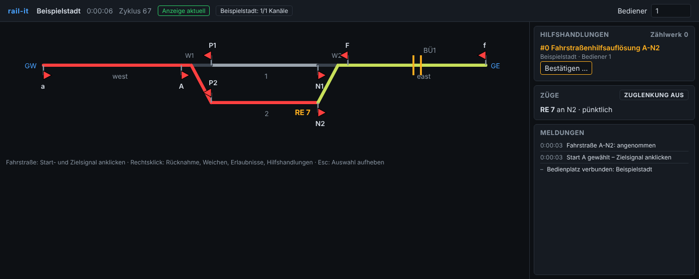
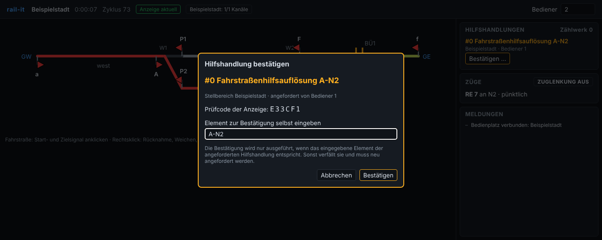
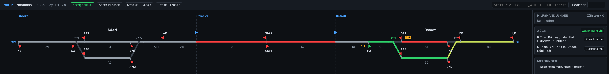
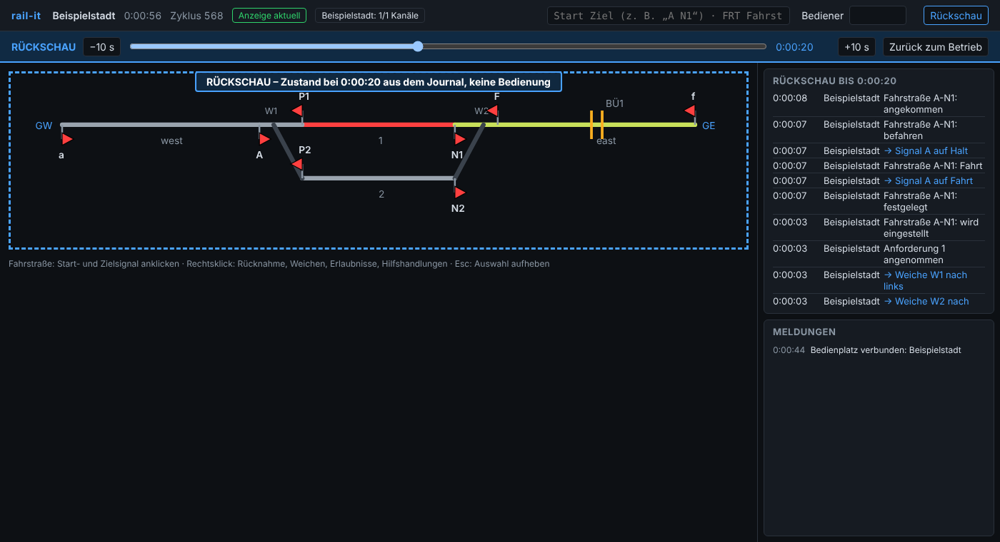

# rail-it


Modulare, in Rust geschriebene Engine für Netz- und Stellwerkmanagement von Bahnsystemen.
Sie umfasst Netzmodell, Fahrwegsicherung (deutsches ESTW), Fahrerlaubnis über Lichtsignale
oder ETCS sowie die Betriebsführung. Sie läuft als Dienst mit API und CLI, auf Linux-Servern
und – für den Sicherheitskern – auf Embedded-Hardware.

- **Konzept:** [docs/KONZEPT.md](docs/KONZEPT.md)
- **API:** [docs/api.md](docs/api.md)
- **Anforderungen:** [docs/requirements/](docs/requirements/)
- **Gefährdungsliste:** [docs/safety/hazard-log.md](docs/safety/hazard-log.md)

> rail-it ist **nicht zugelassen** für den realen Bahnbetrieb. Der Einsatz ist bis zu einer
> Zulassung auf Simulation, Ausbildung, Prüfstände und Labor beschränkt (Konzept,
> Abschnitt 1).

## Stand

Phase 0 (Fundament), Phase 1 (minimaler Kern), Phase 2 (ESTW vollständig: Durchrutschwege,
Flankenschutz, Bahnübergänge, Hilfshandlungen mit Zwei-Personen-Regel, Ersatzsignal,
Erkennung unerlaubter Besetzung, Signalbegriffe Ks und H/V, Journal und Replay) und Phase 3
(Netz und Betrieb: mehrere Stellbereiche mit je eigenem Kern, Streckenblock mit
Erlaubniswechsel, Zugnummernmeldung, Fahrplan, Zuglenkung, Disposition, gRPC-Vertrag,
Benutzer mit Rollen, TLS/mTLS, Auditprotokoll) und Phase 4 (Europa: ETCS Level 2 mit
RBC-Funktion und Mischbetrieb, Feldanbindung über EULYNX SCI und RaSTA, Import und Export von
railML 3) und Phase 5 (Sicherheit und Embedded: redundante Kanäle mit Voter und Watchdog,
Runtime für den sicheren Rechner auf Cortex-R, formale Nachweise mit Kani, Fuzzing,
[Sicherheitsnachweis](docs/safety/safety-case.md) und automatische
[Rückverfolgbarkeit](docs/safety/traceability.md)) und Phase 6 (Bedienplatz: automatisch
berechneter Spurplan, Web-Bedienplatz mit Anzeigeüberwachung und sicherer Anzeige- und
Bestätigungskette für Hilfshandlungen) und Phase 7 (Betriebsreife: der sichere Rechner als
Knoten im Dienst mit Spiegel und Zustandsabgleich (`railit-node`, `railitd --node`), robuste
RaSTA-Wiederholung, gesiegeltes Journal und Auditprotokoll, Bedienplatz für Netz und Betrieb,
Leistungsziele in der CI gemessen, siehe [Leistung](#leistung)) und Phase 8 (Verfügbarkeit
und Diagnose: Journal auch im Knotenbetrieb, Zustand und Ereignisse zu jedem Zeitpunkt aus dem
Journal, Metriken unter `/v1/metrics`) und Phase 9 (Mitlesen und Rückschau: Bereitschaftsrechner
liest das Journal laufend geprüft mit, Rückschau am Bedienplatz) und Phase 10 (Übernahme:
Feldrechner mit Umschalter, Ausgabe erst nach Quittung, Übernahme des Betriebs durch den
Bereitschaftsrechner, siehe [Übernahme](#übernahme)) und Phase 11 (Nachbarstellwerke: Grenzmeldungen
zwischen den Stellbereichen über EULYNX SCI-ILS und RaSTA mit störbarer Strecke, auch zwischen
getrennten Prozessen mit Umschalter je Stellbereich am Feldrechner, siehe
[ETCS, EULYNX und railML](#etcs-eulynx-und-railml)) sind umgesetzt.

| Crate | Inhalt | |
|-------|--------|---|
| `railit-types` | Typsichere IDs, Längen, Zeit, Weichenlagen, Bitsets | `no_std`, ohne Allokator |
| `railit-topology` | Netzmodell mit Ports, Validierung, Navigation durch Weichen | `no_std` + `alloc` |
| `railit-plan` | Plan-Image: Binärformat, Zero-Copy-Sicht, SHA-256, Ed25519 | `no_std`, ohne Allokator |
| `railit-planning` | Fahrstraßen, Durchrutschwege, Flankenschutz, Feindlichkeiten; unabhängige Gegenprüfung | |
| `railit-rules` | Regelwerk-Schnittstelle, Lehrregelwerk | `no_std` |
| `railit-kernel` | Sicherheitskern: Fahrwegsicherung, Hilfshandlungen, Invarianten, sicherer Zustand | `no_std`, ohne Allokator |
| `railit-movement` | Signalbegriffe Ks und H/V und ETCS-Fahrerlaubnis aus dem Kernzustand | `no_std`, ohne Allokator |
| `railit-safety` | Redundante Kanäle, Voter (2-von-2, 2-von-3), Watchdog, sicherer Zustand | `no_std`, ohne Allokator |
| `railit-embedded` | Runtime für den sicheren Rechner (Cortex-R): Knoten mit Kanälen, Binärprotokoll über RaSTA | `no_std`, ohne Allokator |
| `railit-etcs` | RBC-Funktion für ETCS Level 2: Anmeldung, Fahrerlaubnis über Bereichsgrenzen, Notbremsung | |
| `railit-rasta` | RaSTA-Sicherheits- und Wiederholschicht nach EN 50159 | `no_std`, ohne Allokator |
| `railit-adapters` | Feldanbindung über EULYNX SCI-P/-LS/-TDS/-LX und RaSTA zu simulierten Objektsteuerungen, im Dienst oder über UDP zu einem Feldrechner mit Umschalter; SCI-ILS zwischen Nachbarstellwerken | |
| `railit-journal` | Betriebsjournal mit Hashkette, Prüfpunkten, Siegeln, Zustandsabzügen und parallelem Replay; Auditprotokoll | |
| `railit-sim` | Simulator: Weichen, Signale, Gleisfreimeldung, Bahnübergänge, Züge (auch mit ETCS), Störungen | |
| `railit-ops` | Zugnummernmeldung, Fahrplan, Zuglenkung, Selbstblock, Disposition | |
| `railit-runtime` | Zyklus Kerne ↔ Feld für mehrere Stellbereiche, Zustandsbild, Szenarien, Schlüssel | |
| `railit-import` | rail-it-TOML, railML 3 (Import und Export) | |
| `railit-layout` | Spurplan: schematische Geometrie aus der Topologie, SVG-Export | |
| `railit-fuzz` | Fuzz-Ziele für alle Eingangsschnittstellen (mit `fuzz/` für cargo-fuzz) | |
| `railit-field` | Feldrechner als eigener Prozess: simulierte Objektsteuerungen über RaSTA/UDP, Umschalter zwischen Haupt- und Bereitschaftsrechner, Steuerung der Simulation | |
| `railit-node` | Knoten des sicheren Rechners als Serverprogramm: Kern mit Voter und Watchdog, eigener Takt, RaSTA über UDP | |
| `railitd` | Dienst mit REST/JSON-API, gRPC (`proto/railit/v1`), Ereignisstrom, Rollen, TLS/mTLS, Audit, Bedienplatz unter `/ui/` | |
| `apps/railitd/ui` | Bedienplatz: Spurplan-UI in TypeScript mit bQuery, gebaut mit Bun | SIL 0, reiner API-Client |
| `railit` | Kommandozeile (offline und online) | |

## Installation

Fertige Programme (`railit`, `railitd`, `railit-field`, `railit-node`) für Linux (x86_64,
aarch64), macOS (Intel, Apple Silicon) und Windows (x86_64) liegen bei jedem
[Release](https://github.com/JosunLP/rail-it/releases):

```sh
curl -fsSL https://josunlp.github.io/rail-it/install.sh | sh              # Linux, macOS
irm https://josunlp.github.io/rail-it/install.ps1 | iex                   # Windows (PowerShell)
railit self check        # neues Release verfügbar?
railit self update       # aktualisieren
railit self uninstall    # entfernen
```

Der Installer legt die Programme nach `~/.local/bin` (als root `/usr/local/bin`, Windows
`%LOCALAPPDATA%\Programs\rail-it\bin`), die Beispielnetze nach `…/share/rail-it/examples` und
prüft jede Datei gegen die Prüfsummen des Releases. Eine bestimmte Version:
`curl -fsSL https://josunlp.github.io/rail-it/install.sh | sh -s -- --version 0.11.0`.
Dokumentation: <https://josunlp.github.io/rail-it/>.

## Schnellstart

Aus dem Quelltext (Rust 1.97, für den Bedienplatz Bun ≥ 1.4):

```sh
(cd apps/railitd/ui && bun install && bun run build)
cargo build --release
export PATH="$PWD/target/release:$PATH"

# Netz prüfen, Schlüssel erzeugen, Plan kompilieren und signieren
railit net validate examples/beispielstadt.toml
railit plan keygen railit
railit plan compile examples/beispielstadt.toml --out beispielstadt.rplan --key railit.key
railit plan info beispielstadt.rplan

# Betriebsszenarien ausführen
railit scenario run tests/scenarios/*.toml

# Dienst starten (Simulation mit 10-fachem Zeitraffer, mit Betriebsjournal)
railitd --network examples/beispielstadt.toml --plan beispielstadt.rplan \
        --trusted-key railit.pub --speed 10 --journal betrieb.journal &

# Bedienen
railit sim train add RE1 --at A --length 120 --speed 80
railit route set A-N1
railit watch            # Ereignisse fortlaufend, Strg+C beendet
railit state            # Signalbilder, Verschlüsse, Bahnübergänge, Hilfshandlungen

# Hilfshandlung: Bediener 1 fordert an, Bediener 2 bestätigt und nennt sie dabei selbst
railit aux request release-route A-N1 --operator 1
railit aux confirm 0 release-route A-N1 --operator 2

# Spurplan als SVG (für Dokumentation und Projektierung)
railit net layout examples/beispielstadt.toml --out beispielstadt.svg

# Journal prüfen und abspielen
railit journal verify betrieb.journal
railit journal replay betrieb.journal --plan beispielstadt.rplan
```

### Bedienplatz

`railitd` liefert einen Web-Bedienplatz aus: <http://127.0.0.1:7878/> öffnen (bei
`--speed 10` wie oben). Der Spurplan wird aus der Topologie berechnet (`/v1/layout`).

- Fahrstraße: Start- und Zielsignal anklicken; Rechtsklick auf Signal, Weiche, Abschnitt oder
  Grenze für Rücknahme, Umstellen, Erlaubnisse und Hilfshandlungen.
- Hilfshandlungen bestätigt ein zweiter Bediener (eigene Bedienernummer oben rechts, eigener
  Browser-Tab) im Dialog: Er gibt das Element selbst ein, der Bedienplatz prüft den Prüfcode
  seiner Anzeige gegen den des Stellwerks, der Kern führt nur eine unverändert wiederholte
  Hilfshandlung aus.
- Kommt 2 s lang kein aktuelles Zustandsbild, deckt der Bedienplatz den Spurplan ab und sperrt
  jede Bedienung.
- Tastatur wie am Stelltisch: `A N1` (Fahrstraße), `FRT A-N1` (Rücknahme), `W1 L` (Weiche).
- Betriebsführung: Zuglenkung ein/aus, Züge zurückhalten und freigeben; Zugnummern stehen am
  Signal, Grenzen zeigen, wer die Erlaubnis hält.









Entwicklung des Bedienplatzes (Bun ≥ 1.4): `cd apps/railitd/ui && bun install && bun run
build`; Prüfungen mit `bun run check`, `bun run test` und `bun run e2e` (Playwright gegen
einen echten `railitd`, vorher `cargo build -p railit -p railitd`). Das gebaute Bundle
`apps/railitd/ui/dist` wird nicht eingecheckt: CI und Release bauen den Bedienplatz in der
Pipeline, `railitd` bettet ihn beim Bauen ein (`build.rs`). Ohne gebauten Bedienplatz zeigt
`railitd` unter `/ui/` eine Hinweisseite; mit `RAILIT_REQUIRE_UI=1` bricht der Build ab.

### Sicherer Rechner

Der Kern eines Stellbereichs kann auf einem eigenen Knoten rechnen (Konzept, Abschnitt 13):
`railit-node` führt ihn mit 2 oder 3 Kanälen, Voter und Watchdog im eigenen Takt aus und
spricht über RaSTA auf UDP mit `railitd`. Der Dienst wendet nur die Befehle des Knotens an und
führt einen per Digest geprüften Spiegel für Anzeige und Betrieb.

```sh
railit-node --plan beispielstadt.rplan --trusted-key railit.pub --listen 127.0.0.1:7979 &
railitd --network examples/beispielstadt.toml --plan beispielstadt.rplan \
        --trusted-key railit.pub --node 127.0.0.1:7979 &
# Netze mit Stellbereichen: --node Adorf=…:7979 --node Strecke=…:7980 …

# Alle Szenarien über Knoten im Gleichschritt (vollständiges Protokoll, deterministisch)
railit scenario run --node tests/scenarios/*.toml
```

### Netz mit mehreren Bahnhöfen: Nordbahn

Drei Stellbereiche (Bahnhof Adorf, eingleisige Strecke mit Selbstblock, Bahnhof Bstadt), je
mit eigenem Kern; ein Fahrplan lässt zwei Züge mit Zuglenkung verkehren.

```sh
railit plan compile examples/nordbahn.toml --out nordbahn/ --key railit.key

railitd --network examples/nordbahn.toml --plan nordbahn/ --trusted-key railit.pub \
        --timetable examples/nordbahn-fahrplan.toml --ars --speed 10 &

railit areas            # Stellbereiche, Grenzen, Erlaubnisse
railit ops list         # Züge mit Zugnummer, nächstem Halt, Verspätung
railit ops hold RE1     # Disposition: zurückhalten, Gleiswechsel, Wartezeit
railit border request 'Strecke>Adorf'   # Anführungszeichen: > ist ein Shell-Zeichen
railit scenario run tests/scenarios/1[3-5]_*.toml
```

### ETCS, EULYNX und railML

```sh
# ETCS Level 2: Zug mit Fahrzeuggerät fährt nach der Fahrerlaubnis des RBC
railit scenario run tests/scenarios/16_nordbahn_etcs.toml tests/scenarios/17_etcs_notbremsung.toml
railit etcs             # angemeldete Züge, Betriebsart, Fahrerlaubnis (online)

# Feldanbindung über EULYNX SCI und RaSTA statt direkt am Simulator
railitd --network examples/beispielstadt.toml --plan beispielstadt.rplan \
        --trusted-key railit.pub --field eulynx &

# Redundanz: drei Kanäle je Stellbereich (2-von-3) mit Watchdog
railitd --network examples/beispielstadt.toml --plan beispielstadt.rplan \
        --trusted-key railit.pub --channels 3 --watchdog-ms 50 &
railit safety                     # Redundanz, mitwählende Kanäle, Abschaltung
railit safety fault 2 stall       # Prüfung: Kanal 2 fällt aus und wird ausgeschlossen
railit safety reintegrate 2       # Kanal 2 übernimmt den Zustand und wählt wieder mit
railit scenario run tests/scenarios/2[01]_*.toml

# Nachbarstellwerke: Grenzmeldungen über EULYNX SCI-ILS und RaSTA, Strecke störbar
railitd --network examples/nordbahn.toml --plan nordbahn/ --trusted-key railit.pub \
        --borders ils --speed 10 &
railit ils                                  # Verbindungen zwischen den Stellbereichen
railit ils fault Adorf-Strecke --down       # unterbrechen: Ausfahrt fällt auf Halt
railit scenario run tests/scenarios/22_nordbahn_sci_ils.toml
railit scenario run --ils tests/scenarios/*.toml
# Stellbereiche in getrennten Prozessen: railitd --areas Adorf,Strecke --ils-listen … \
#   --ils-peer Bstadt=…  (siehe docs/leitfaden/stellbereiche.md)

# Netz als railML 3 ausgeben und wieder einlesen
railit net export examples/nordbahn.toml --out nordbahn.railml
railit net validate nordbahn.railml
railit plan compile nordbahn.railml --out nordbahn/ --key railit.key
```

Aus dem Journal lässt sich jeder Zeitpunkt befragen – rekonstruiert ab dem letzten
Zustandsabzug, die Ausgaben neu berechnet und gegen das Journal geprüft:

```sh
railit journal state  betrieb.journal --plan plan.rplan --at 20        # Zustand bei t = 20 s
railit journal events betrieb.journal --plan plan.rplan --from 0 --to 90
railit scenario run tests/scenarios/*.toml --node --journal            # mitschreiben und abspielen
railit journal follow betrieb.journal --plan plan.rplan                # wachsendes Journal mitlesen
```

Ein zweiter Dienst kann als **Bereitschaftsrechner** mitlesen: `railitd … --standby
http://hauptrechner:7070` folgt dem Journal des Hauptrechners, rechnet jede Zeile nach und zeigt
dessen Zustand am Bedienplatz an – ohne Bedienung. Im Bedienplatz zeigt die **Rückschau** den
Spurplan zu jedem vergangenen Zeitpunkt.

### Übernahme

Fällt der Hauptrechner aus, übernimmt der Bereitschaftsrechner den Betrieb. Dazu laufen die
Objektsteuerungen in einem eigenen **Feldrechner**, dessen Umschalter immer nur ein Stellwerk
stellen lässt:

```sh
railit-field --network examples/beispielstadt.toml --listen 127.0.0.1:7900 --control 127.0.0.1:7901
railitd --network … --plan … --listen 127.0.0.1:7070 --field remote --field-addr 127.0.0.1:7900 \
        --field-control http://127.0.0.1:7901 --journal haupt.journal --standby-gate-ms 8000
railitd --network … --plan … --listen 127.0.0.1:7071 --field remote --field-addr 127.0.0.1:7900 \
        --field-control http://127.0.0.1:7901 --journal bereitschaft.journal \
        --standby http://127.0.0.1:7070 --takeover-after-ms 500
```

Der Hauptrechner gibt jede Ausgabe erst frei, wenn der Bereitschaftsrechner den Zyklus
quittiert hat, und sagt ihm zu, die Sperre eine Weile zu halten. Schweigt der Hauptrechner,
holt sich der Bereitschaftsrechner die Führung am Feldrechner; innerhalb der Zusage übernimmt
er den mitgelesenen Zustand (Verschlüsse bleiben, Fahrstraßen mit Fahrt stehen auf Halt),
sonst beginnt er wie nach einem Neustart. Ein Property-Test lässt den Hauptrechner an
zufälligen Stellen mit fahrenden Zügen ausfallen; die Gegenprobe zeigt, dass ein
Bereitschaftsrechner ohne Sperre einen Bahnübergang vor einem Zug öffnen würde
([API](docs/api.md#übernahme), [Sicherheitsnachweis](docs/safety/safety-case.md), G7).

Journal und Auditprotokoll lassen sich mit dem Schlüssel des Stellwerks siegeln:
`railitd … --journal betrieb.journal --audit audit.log --seal-key stellwerk.key`, geprüft mit
`railit journal verify betrieb.journal --key stellwerk.pub --require-seal` bzw.
`railit audit verify audit.log --key stellwerk.pub`.

Für den Betrieb mit Benutzern: `railitd … --users users.toml --audit audit.log
--tls-cert server.pem --tls-key server.key [--tls-client-ca ca.pem]`; die CLI meldet sich mit
`--token` bzw. `--ca`, `--cert`, `--key` an (siehe [API](docs/api.md)).

Releases entstehen über den Workflow *Release* (Actions → Release → Version eingeben):
`cargo xtask release X.Y.Z` hebt die Version an und schreibt `CHANGELOG.md`, der Workflow
setzt den Tag, baut für alle Plattformen, prüft den Installer gegen jedes Archiv und
veröffentlicht das Release mit Prüfsummen.

Exit-Codes der CLI: `0` Erfolg, `1` ungültig oder abgelehnt, `2` Bedien-, Lese- oder
Verbindungsfehler. Mit `--output json` liefern alle Befehle JSON.

## Leistung

`railit bench` erzeugt einen Korridor beliebiger Größe (`railit net generate`), projektiert
ihn und misst gegen die Ziele aus dem Konzept (Abschnitt 15). Last: alle Elemente melden in
jedem Zyklus, dazu laufend Fahrstraßenanforderungen und Rücknahmen. Die CI bricht mit
`--check` ab, wenn ein Ziel verfehlt ist. Messung auf 4 Kernen bei 5004 Elementen
(236 Bahnhöfe, 1888 Fahrstraßen):

| Kennzahl | Ziel | gemessen |
|----------|------|----------|
| Kernzyklus p99 | < 1 ms | 0,13–0,20 ms |
| Zulassungsprüfung einer Fahrstraße | < 10 µs | ≈ 0,6 µs |
| Replay von 24 h Betrieb (hochgerechnet) | < 60 s | 34–36 s |

```sh
railit bench                      # Voreinstellung: 236 Bahnhöfe, 6000 Zyklen
railit bench --stations 20 --check --output json
railit net generate --stations 50 --out korridor.toml
```

Die Invariantenprüfung nach jedem Zyklus ist linear in der Netzgröße (REQ-IXL-023); das
Journal speichert die Eingaben als Änderung zum vorigen Zyklus und enthält alle zehn Minuten
einen Zustandsabzug, so dass das Replay die Abschnitte parallel abspielt (REQ-JRN-005/006).

## Entwicklung

```sh
cargo fmt --all -- --check
cargo clippy --workspace --all-targets --all-features -- -D warnings
cargo test --workspace --all-features
cargo build --target armv7r-none-eabihf \
      -p railit-types -p railit-topology -p railit-plan -p railit-rules -p railit-kernel \
      -p railit-movement -p railit-rasta -p railit-safety -p railit-embedded
cargo deny check
cargo xtask trace            # Rückverfolgbarkeit prüfen, docs/safety/traceability.md erzeugen
(cd docs && bun install && bun run gen && bun run dev)   # Dokumentation lokal (VitePress)
cargo run --release -p railit -- bench --check   # Leistungsziele (Konzept, Abschnitt 15)
PROPTEST_CASES=10000 cargo test --release -p railit-kernel --all-features \
      --test invariants --test borders
PROPTEST_CASES=10000 cargo test --release -p railit-rasta --test rasta

# Formale Nachweise (Kani) und Fuzzing (Nightly, cargo-fuzz)
cargo kani -p railit-safety && cargo kani -p railit-types && cargo kani -p railit-embedded
cargo kani -p railit-rasta -Z stubbing
sh fuzz/seed.sh && cargo +nightly fuzz run plan_image -- -max_total_time=60
```

Die Toolchain ist in `rust-toolchain.toml` festgelegt. Die sicherheitsrelevanten Crates
verbieten `unsafe`, `unwrap`, `panic`, direkte Indexierung, ungeprüfte Arithmetik und
Gleitkommazahlen.

## Lizenz

rail-it steht unter der [Non-Commercial Source License (NCSL) v1.0](LICENSE). Nicht
kommerzielle Nutzung ist erlaubt. Für jede kommerzielle Nutzung ist eine schriftliche Lizenz
nötig: support@josunlp.de
