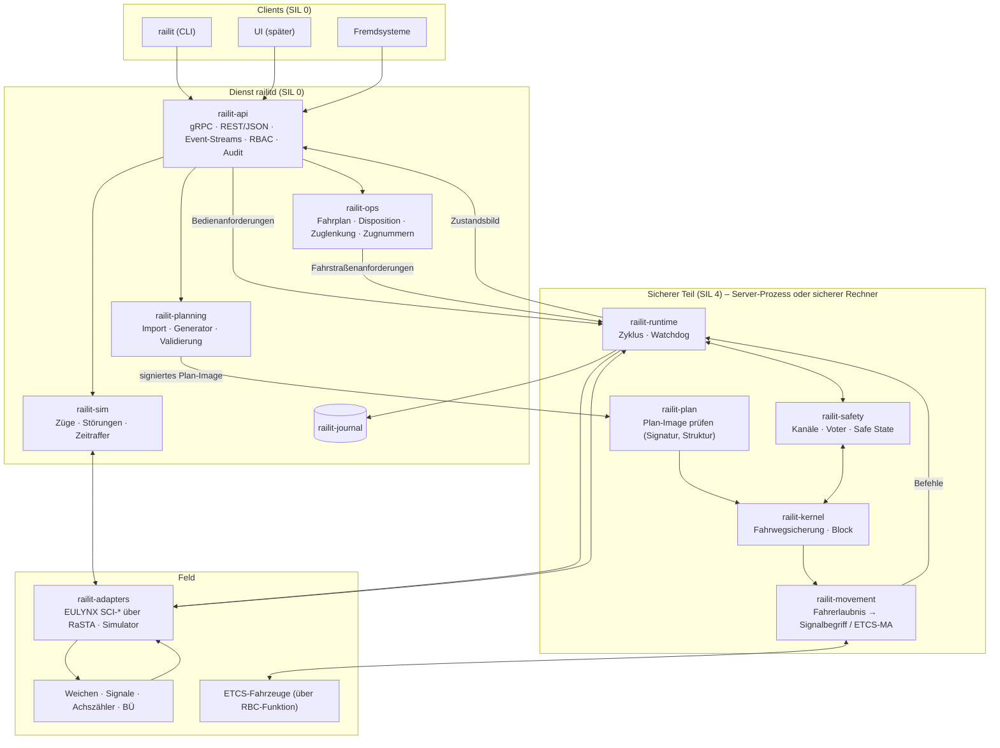
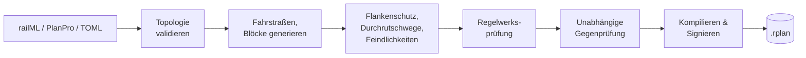
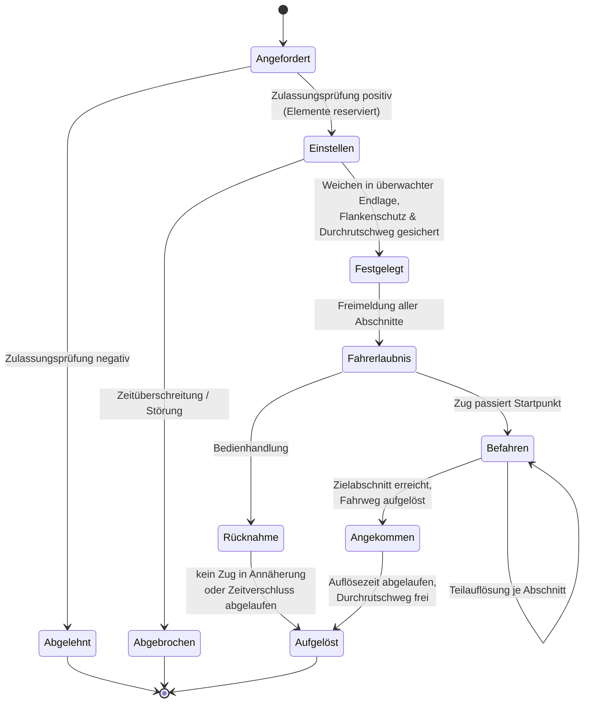

# rail-it – Konzept einer Engine für Netz- und Stellwerkmanagement

> Status: **v0.12** (Phasen 0 bis 10 umgesetzt) · Sprache der Implementierung: **Rust** · Lizenz: **NCSL v1.0**
>
> v0.2 arbeitet die Grundsatzentscheidungen aus Abschnitt 2 ein: vollständiger Netz- und
> Bahnbetrieb, deutsches ESTW **und** europäisches System (ETCS/EULYNX), Server **und**
> Embedded, API-first-Dienst mit CLI.

---

## 1. Zielbild

**rail-it** ist eine in Rust geschriebene Engine für den **vollständigen Betrieb eines
Schienennetzes**. Sie umfasst vier Ebenen:

1. **Netzmanagement:** ein exaktes, maschinenlesbares Modell der Infrastruktur. Dazu gehören
   Gleise, Weichen, Kreuzungen, Signale, Gleisfreimeldeabschnitte, Bahnübergänge, Strecken,
   Blockabschnitte, Betriebsstellen und Stellbereiche, jeweils mit Topologie und Geometrie.
2. **Fahrwegsicherung (Stellwerk):** die sicherheitsrelevante Steuerung. Sie bildet
   Fahrstraßen, setzt Verschlüsse, sichert Flankenschutz und Durchrutschwege, löst Fahrstraßen
   auf, führt den Streckenblock und die Hilfshandlungen. Sie folgt der Logik des deutschen ESTW
   bzw. DSTW.
3. **Zugsicherung / Fahrerlaubnis:** die Übergabe der Fahrerlaubnis an den Zug. Sie geschieht
   klassisch über Lichtsignale (Ks, H/V, mit PZB) oder europäisch über **ETCS Level 2** mit
   Movement Authorities aus einem RBC.
4. **Betriebsführung:** Fahrplan, Disposition, Zuglenkung, Zugnummernmeldung und
   Zuglaufverfolgung, dazu Diagnose, Protokollierung und Auswertung.

### Qualitätsziele

| Ziel              | Was das konkret heißt |
|-------------------|------------------------|
| **Sicher**        | Jeder Zweifel führt in den restriktiven Zustand. Der sicherheitsrelevante Kern ist strikt vom Rest getrennt. Der Kern wird von Beginn an nach den Maßstäben für SIL 4 entwickelt: kein `unsafe`, keine Panics, keine dynamische Allokation. |
| **Verlässlich**   | Deterministisch: Gleiche Eingaben ergeben bitgleiche Ausgaben. Jeder Zustand lässt sich aus dem Ereignisprotokoll rekonstruieren. Redundanz ist als 2-von-2 und 2-von-3 möglich. |
| **Performant**    | Ein Zyklus des Sicherheitskerns dauert unter 1 ms bei 5 000 Elementen. Die Zulassungsprüfung einer Fahrstraße liegt im Mikrosekundenbereich. Im Zyklus wird kein Speicher allokiert. |
| **Modular**       | Klar geschnittene Crates mit einseitigen Abhängigkeiten. Der Kern kennt weder Netzwerk noch Datenbank noch Hardware. |
| **Erweiterbar**   | Regelwerke, Fahrerlaubnis-Kanäle, Elementtypen, Feldprotokolle und Importformate lassen sich über Traits austauschen, ohne den Kern anzufassen. |
| **Portabel**      | Derselbe Kern läuft auf Linux-Servern und als `no_std`-Firmware auf sicheren Mikrocontrollern. |

### Zulassungspfad

Das Ziel ist realer Betrieb. Dafür reicht gute Software allein nicht. Nötig sind außerdem ein
Sicherheitslebenszyklus nach **EN 50126 / EN 50716 / EN 50129**, sichere Hardware, eine
qualifizierte Toolchain, unabhängige Rollen für Verifikation, Validierung und Begutachtung sowie
eine Zulassung. rail-it legt deshalb **ab Phase 0** die nötigen Grundlagen an (Abschnitt 16):
Anforderungen mit IDs, eine Gefährdungsliste, Rückverfolgbarkeit und Nachweise.

Bis zu einer Zulassung ist der Einsatz auf Simulation, Ausbildung, Prüfstände und Testlabore
beschränkt. Diese Einsatzfelder sind zugleich Meilensteine auf dem Weg dorthin.

---

## 2. Getroffene Entscheidungen

| # | Frage | Entscheidung | Folgen für die Architektur |
|---|-------|--------------|----------------------------|
| E1 | Einsatzzweck | Vollständiger Netz- und Bahnbetrieb | Strecke, Block, Betriebsführung und Zugsicherung kommen in den Umfang. Der Sicherheitslebenszyklus beginnt sofort. |
| E2 | Regelwerk | Deutsches ESTW/DSTW **und** europäisches System | Zwischen Fahrwegsicherung und Signalisierung liegt eine Fahrerlaubnis-Abstraktion (Abschnitt 9). Regelwerke: `de-estw`, `etcs`. Feldanbindung nach EULYNX. |
| E3 | Datenformat | railML 3 für den Austausch, PlanPro als deutscher Import, eigenes TOML für Tests und Beispiele, signiertes Binär-Image für den Kern | Siehe Abschnitt 6 |
| E4 | Plattform | Linux-Server **und** Embedded | Kern ist `no_std` ohne `alloc`. Der Plan wird ohne Kopie direkt aus dem Speicher gelesen. Zustandspuffer stellt der Aufrufer (Abschnitt 13). |
| E5 | Bedienung | Zuerst Dienst mit umfassender API und CLI, später UI | API-first mit Protobuf/gRPC als Vertrag. Die CLI ist ein API-Client. Eine UI kommt später als weiterer Client dazu (Abschnitt 14). |
| E6 | Lizenz | Eigene Lizenz: **Non-Commercial Source License (NCSL) v1.0** | Nur Abhängigkeiten mit freizügigen Lizenzen; Copyleft ist ausgeschlossen und wird per `cargo-deny` erzwungen. Cargo nutzt `license-file`. |

---

## 3. Architekturprinzipien

1. **Functional Core, Imperative Shell.** Der Kern ist eine reine Zustandsmaschine:
   `(Zustand, Eingaben, Zeit) → (neuer Zustand, Befehle)`. Er führt keine I/O aus, liest keine
   Uhr und allokiert nichts.
2. **Fail-safe über das Typsystem.** Nur ein positiv bestätigter Zustand gilt als sicher.
   `Occupancy::Disturbed` behandelt die Logik wie „besetzt“. Eine Weiche ohne überwachte Endlage
   ist „nicht in Lage“.
3. **Daten statt Code.** Die Anlage wird projektiert, nicht programmiert. Der Kern ist generisch
   und arbeitet auf geprüften Projektierungsdaten.
4. **Einseitige Abhängigkeiten.** Sicherheitsrelevante Crates hängen nie von nicht
   sicherheitsrelevanten ab. Betriebsführung, API und UI stellen nur *Anforderungen*. Befehle an
   Feldelemente und Fahrerlaubnisse erzeugt ausschließlich der Kern.
5. **Event Sourcing.** Jede Eingabe wird vor der Verarbeitung protokolliert. Das ermöglicht
   Replay, Störungsanalyse, Redundanzabgleich und Regressionstests mit Realdaten.
6. **Explizite Zustände.** Es gibt keinen versteckten oder globalen Zustand. Der Kernzustand
   lässt sich hashen, vergleichen und als Snapshot sichern.
7. **Partitionierung statt Locks.** Ein großes Netz besteht aus vielen Stellbereichen mit je
   einem eigenen, single-threaded Kern. Sie kommunizieren über definierte Schnittstellen.

---

## 4. Systemüberblick



**Datenfluss in einem Zyklus**

1. Adapter und API legen ihre Eingaben in einen begrenzten Eingangspuffer.
2. Die Runtime schließt den Zyklus. Sie stempelt die Eingaben mit der Zeit, schreibt sie ins
   Journal und übergibt sie geordnet an den Kern.
3. Der Kern berechnet Zustand, Stellbefehle und Fahrerlaubnisse, bei Redundanz auf allen Kanälen.
4. Der Voter vergleicht die Ergebnisse. Bei einer Abweichung geht das System in den sicheren
   Zustand.
5. Die Befehle gehen an die Adapter, das Zustandsbild an API und Betriebsführung.

---

## 5. Modulschnitt (Cargo-Workspace)

```
rail-it/
├── Cargo.toml                  # Workspace, gemeinsame Lints & Profile
├── crates/
│   ├── railit-types/           # IDs, Einheiten, Zeit, Bitsets                 SIL 4 · no_std
│   ├── railit-topology/        # Infrastrukturgraph, Navigation, Validierung    SIL 4 · no_std + alloc
│   ├── railit-plan/            # Plan-Image: Format, Zero-Copy-Sicht, Prüfung   SIL 4 · no_std
│   ├── railit-rules/           # RuleSet-Trait, de-estw, etcs                   SIL 4 · no_std
│   ├── railit-kernel/          # Fahrwegsicherung, Streckenblock                SIL 4 · no_std
│   ├── railit-movement/        # Fahrerlaubnis → Lichtsignal / ETCS-MA          SIL 4 · no_std
│   ├── railit-safety/          # Kanäle, Voter, Watchdog, Safe State            SIL 4 · no_std
│   ├── railit-runtime/         # Zyklussteuerung (std und Embedded-Variante)    SIL 4
│   ├── railit-planning/        # Fahrstraßengenerator, Validierung, Signierung  SIL 0 (+ unabh. Prüfer)
│   ├── railit-import/          # railML 3, PlanPro, rail-it-TOML                SIL 0
│   ├── railit-layout/          # Spurplan-Geometrie aus der Topologie, SVG      SIL 0
│   ├── railit-journal/         # Event-Log, Hash-Kette, Snapshots, Replay       SIL 0 (Diagnose)
│   ├── railit-adapters/        # eulynx/, rasta/, sim/                          SIL 4 (RaSTA) / 0
│   ├── railit-ops/             # Fahrplan, Disposition, ARS, Zugnummern         SIL 0
│   ├── railit-sim/             # Zugbewegung, Gleisfreimeldung, Fehlerinjektion SIL 0
│   ├── railit-proto/           # Protobuf-Verträge der API (railit.v1)
│   └── railit-api/             # gRPC/REST-Server, AuthN/Z, Audit               SIL 0
├── apps/
│   ├── railitd/                # Dienst
│   │   └── ui/                 # Bedienplatz (TypeScript, bQuery, Bun)          SIL 0
│   └── railit/                 # CLI
├── examples/                   # Beispielnetze (TOML)
├── tests/scenarios/            # Deklarative Betriebsszenarien
└── docs/
    ├── KONZEPT.md
    ├── requirements/           # Anforderungen mit IDs
    └── safety/                 # Gefährdungsliste, Sicherheitsnachweis
```

**Abhängigkeitsregel** (die CI prüft sie):

```
types ← topology ← plan ← rules ← kernel ← movement ← safety ← runtime ← {api, ops, adapters}
                     ↑
               planning ← import
```

Crates mit SIL 4 dürfen nur von Crates mit SIL 4 abhängen. Externe Abhängigkeiten sind dort
auf ein Minimum beschränkt und werden einzeln begründet.

---

## 6. Datenformate

| Zweck | Format | Begründung |
|-------|--------|------------|
| Austausch Infrastruktur, Stellwerk, Fahrplan | **railML 3.x** | Europäischer Standard. Deckt Infrastruktur, Interlocking und Fahrplan ab und ist mit RailTopoModel kompatibel. |
| Deutsche Projektierungsdaten | **PlanPro** (Import) | Datenmodell der DB für ESTW- und DSTW-Planung. Ohne PlanPro gibt es keine realen deutschen Anlagen. |
| Handgeschriebene Netze, Tests, Beispiele | **rail-it-TOML** | railML ist zu ausführlich, um Testfälle von Hand zu schreiben. Das TOML ist kompakt, gut zu diffen und gut zu reviewen. |
| Eingabe des Kerns | **Plan-Image `.rplan`** | Eigenes Binärformat mit Versionsheader, Hash und Ed25519-Signatur. Wird ohne Kopie gelesen und funktioniert auf Embedded ohne Parser. |
| API | **Protobuf** (gRPC) und JSON-Abbildung | Typsicherer, versionierter Vertrag mit generierbaren Clients in allen Sprachen. |
| Journal | Eigenes Binärformat, append-only | Hash-Kette, schnelles Replay |

Die Formate unterscheiden sich, das Modell dahinter ist eines: Alle Importer erzeugen dieselbe
interne `Topology`, aus der `railit-planning` das Plan-Image kompiliert.

---

## 7. Netzmodell (`railit-topology`)

### 7.1 Modellierung

Das Modell lehnt sich an **RailTopoModel / railML 3** und **EULYNX/PlanPro** an, ist aber auf
Rechenzeit optimiert.

- **Knoten mit Ports:** Jedes Element hat benannte Anschlüsse. Ein Gleisabschnitt hat `A`/`B`,
  eine Weiche `Spitze`/`Links`/`Rechts`, ein Prellbock nur `A`.
- **Verbindungen zwischen Ports:** Kanten verbinden Ports, nicht Elemente. Dadurch ist die
  Fahrtrichtung durch eine Weiche eindeutig, und unzulässige Wege (etwa Links → Rechts) sind
  schon strukturell ausgeschlossen.
- **Punktobjekte** (Signale, Achszählpunkte, Isolierstöße, Gleissperren, ETCS-Balisen, Tafeln)
  liegen mit Position und Wirkrichtung auf einem Gleisabschnitt.
- **Logische Ebenen** liegen darüber: Gleisfreimeldeabschnitte (TVD), Blockabschnitte,
  Strecken, Betriebsstellen, Stellbereiche und ETCS-Bereiche.

### 7.2 Speicherlayout

```rust
/// Typsichere Indizes statt Referenzen oder Rc<RefCell<..>>.
pub struct PointId(u32);

pub struct Topology {
    tracks:  Vec<Track>,        // Arena, Index = TrackId
    points:  Vec<Point>,
    signals: Vec<Signal>,
    tvds:    Vec<TvdSection>,
    links:   Vec<Link>,          // Port ↔ Port
    names:   NameIndex,          // fachliche ID ("W12") ↔ Index
}
```

Arenen mit `u32`-Indizes sind cachefreundlich, kommen ohne Referenzzählen aus und lassen sich
direkt in das Plan-Image kompilieren. Nach dem Laden ist die Topologie unveränderlich.

### 7.3 Validierung

Vor jeder Verwendung wird geprüft:

- Alle Namen sind eindeutig.
- Kein Port ist offen (außer an der Netzgrenze), keiner doppelt verbunden.
- Jedes Punktobjekt liegt innerhalb seines Gleises.
- Die Gleisfreimeldeabschnitte decken das Netz lückenlos und überlappungsfrei ab.
- Jede Weiche liegt in genau einem TVD-Abschnitt.

---

## 8. Projektierung (`railit-planning`, `railit-plan`)



Pro Fahrstraße enthält der Plan:

- Start- und Ziel sowie die Art (Zug- oder Rangierstraße),
- die Weichenlagen,
- die TVD-Abschnitte in Fahrreihenfolge,
- die Durchrutschwege,
- die Flankenschutzelemente,
- die feindlichen Fahrstraßen,
- das Geschwindigkeitsprofil.

Alle Mengen werden zu **Bitsets fester Breite** kompiliert. Eine Feindlichkeitsprüfung besteht
dann aus wenigen `AND`-Operationen.

Der Generator gilt als nicht sicherheitsrelevant. Deshalb prüft ein **unabhängiger Prüfer**
seine Ergebnisse: eine zweite Implementierung mit anderen Algorithmen. Nur übereinstimmende Pläne
werden signiert. Eine Aktivierung im Betrieb erfordert zwei Personen.

---

## 9. Fahrerlaubnis-Abstraktion: ESTW und ETCS in einem Kern

Damit das deutsche und das europäische System nebeneinander funktionieren, trennt rail-it zwei
Fragen:

- **Was ist sicher?** Diese Frage beantwortet die Fahrwegsicherung (`railit-kernel`). Sie
  liefert eine abstrakte **Fahrerlaubnis**: von wo bis wo der Fahrweg gesichert ist, mit welchem
  Gefahrpunkt, welchem Durchrutschweg und welchem Geschwindigkeitsprofil.
- **Wie erfährt es der Zug?** Diese Frage beantwortet `railit-movement`. Es übersetzt die
  Fahrerlaubnis über einen *Kanal* in Signalbegriffe oder Movement Authorities.

```rust
pub struct MovementPermission {
    pub route: RouteId,
    pub start: SignalId,              // bzw. ETCS-Halt-Tafel / Marker
    pub end_of_authority: Location,
    pub danger_point: Location,
    pub overlap: Option<OverlapId>,
    pub speed_profile: SpeedProfileRef,
}

pub trait SignallingChannel {
    /// Fahrerlaubnisse dieses Zyklus → kanalspezifische Befehle.
    fn render(&mut self, permissions: &[MovementPermission], out: &mut CommandBuffer);
}
```

| Kanal | Ausgabe | Regelwerk |
|-------|---------|-----------|
| `lineside::ks` | Ks-Signalbegriffe, Zusatzanzeiger (Zs3/Zs3v), PZB-Wirkung | `de-estw` |
| `lineside::hv` | H/V-Signalbegriffe, PZB-Wirkung | `de-estw` |
| `etcs::l2` | Movement Authorities (EoA, Danger Point, Overlap, statisches Geschwindigkeitsprofil) an die RBC-Funktion | `etcs` |

**Stand Phase 2:** `railit-movement` setzt die Kanäle Ks und H/V um. Es berechnet die
Signalbilder als reine Funktion aus Plan und Kernzustand (`Pictures`): Hauptsignale zeigen
einen Fahrtbegriff genau dann, wenn der Kern Fahrt befohlen hat, Vorsignale kündigen das
nächste Hauptsignal an, Geschwindigkeitsbeschränkungen erscheinen als Zs3/Zs3v bzw. Hp2/Vr2
(REQ-MOV-001 bis 003).

**Stand Phase 4:** Der Kanal `etcs::l2` berechnet die Fahrerlaubnis (Movement Authority) ebenso
als reine Funktion aus Plan und Kernzustand: `EoA` am Ende der Kette von Fahrstraßen mit Fahrt,
Gefahrpunkt am Ende des Durchrutschwegs, statisches Geschwindigkeitsprofil aus den
Fahrstraßen (REQ-MOV-004). Das Plan-Image v4 enthält dafür die Längen der Abschnitte. Die
RBC-Funktion `railit-etcs` meldet Züge an und ab, setzt die Fahrerlaubnis über Bereichsgrenzen
fort und löst eine Notbremsung aus, wenn ein fahrender Zug seine Fahrerlaubnis verliert
(REQ-ETCS-001 bis 003). Lichtsignale und ETCS laufen auf demselben Kernzustand; Szenario 16
zeigt Mischbetrieb über drei Stellbereiche.

Ein Abschnitt kann **mehrere Kanäle zugleich** haben, etwa ETCS Level 2 mit Lichtsignalen als
Rückfallebene. Das ist im Mischbetrieb der Normalfall. Für ETCS mit Moving Block bzw. Hybrid
Level 3 ist das Konzept der *Virtual Sub-Sections* (VSS) vorgesehen: Belegung entsteht dann
aus der Gleisfreimeldung **und** aus Positionsmeldungen der Züge.

---

## 10. Fahrwegsicherung (`railit-kernel`)

### 10.1 Schnittstelle

```rust
#![no_std]
#![forbid(unsafe_code)]

pub struct Interlocking<'p, R: RuleSet> {
    plan:  PlanView<'p>,           // geprüftes Plan-Image, zero-copy
    rules: R,
    state: KernelState<'p>,        // Puffer vom Aufrufer, Größe aus dem Plan-Header
}

impl<'p, R: RuleSet> Interlocking<'p, R> {
    /// Ein Zyklus. Keine I/O, keine Uhr, keine Allokation, keine Panics.
    pub fn step(&mut self, now: Tick, inputs: &[Input], out: &mut Outputs)
        -> Result<StepReport, SafeStateReason>;
}
```

`Input` umfasst Element-Meldungen (Weiche, Signal, TVD, BÜ), Bedienanforderungen, bestätigte
Hilfshandlungen, Meldungen der Nachbarstellwerke und Heartbeats. `Outputs` enthält Stellbefehle
und Fahrerlaubnisse.

### 10.2 Fahrstraßen-Lebenszyklus



### 10.3 Regeln, die in jedem Zyklus gelten

- **Fahrerlaubnis nur bei vollständiger Sicherung.** Entfällt eine Bedingung, wird die
  Fahrerlaubnis sofort zurückgenommen. Das Signal fällt auf Halt, oder die MA wird verkürzt.
- **Verschluss:** Elemente einer festgelegten Fahrstraße lassen sich nicht umstellen.
- **Auflösung nur durch den Zug oder unter Zeitverschluss.** Alles andere ist eine
  zählpflichtige Hilfshandlung.
- **Kommunikationsverlust** zu einem Element bedeutet: gestört, also restriktiv.

### 10.4 Netz: Strecke, Block, Nachbarstellwerke

- **Streckenblock:** Blockabschnitte zwischen Betriebsstellen werden wie Fahrstraßen
  behandelt, mit Erlaubnis- und Gleisfreimeldung im Sinne eines Zentralblocks.
- **Nachbarstellwerke:** Jeder Stellbereich hat einen eigenen Kern. An den Grenzen tauschen
  sie Zustimmungen, Belegungen und Fahrerlaubnisse aus, angelehnt an EULYNX SCI-ILS.
  Grenzüberschreitende Fahrstraßen funktionieren per Anfrage und Zustimmung.
- **Bahnübergänge:** Einschalten, Sicherung überwachen, Freigabe der Fahrerlaubnis nur bei
  gesichertem BÜ.

**Stand Phase 3 – Erlaubniswechsel (Streckenblock):** Ein Netz besteht aus Stellbereichen
mit je eigenem Kern. Wo zwei Bereiche aneinandergrenzen, gibt es eine **Erlaubnis**: Nur die
Seite, die sie hält, darf Züge über die Grenze schicken. Die andere Seite hält ihren
**Annäherungsabschnitt** (von der Grenze bis zum Einfahrsignal samt dessen Durchrutschweg)
verschlossen; nur Fahrstraßen ab dem Einfahrsignal dürfen ihn nutzen, Züge des Nachbarn
dürfen ihn besetzen. Beide Kerne senden sich in jedem Zyklus eine Grenzmeldung (hält
Erlaubnis, laufende Nummer, Angebot, Annäherungsabschnitt frei und ausschließlich
verschlossen, Anforderung).

- **Abgabe** nur auf Anforderung, ohne Fahrstraße über die Grenze, bei freien und gesicherten
  Annäherungsabschnitten auf beiden Seiten; der eigene Abschnitt wird im selben Zyklus
  verschlossen (REQ-IXL-018).
- **Übernahme** nur aus einem Angebot mit größerer Nummer und nicht vor Ablauf der
  Einschwingzeit nach einem (Neu-)Start; das Angebot endet mit der Quittung. Beim Anlauf
  übernimmt der dafür bestimmte Kern, nachdem der Nachbar die Einschwingzeit lang gemeldet hat,
  sie nicht zu halten; dasselbe gilt für die Hilfshandlung „Erlaubnis zurückholen“
  (REQ-IXL-017).
- **Ausfahrt** über die Grenze nur mit Erlaubnis; Fahrt nur bei aktueller Meldung des
  Nachbarn, dass sein Annäherungsabschnitt frei, gesichert und **ausschließlich** verschlossen
  ist (REQ-IXL-020).
- **Eingleisige Strecke** zwischen zwei Bahnhöfen als eigener Bereich mit zwei Grenzen, deren
  Annäherungsabschnitte sich überdecken: Der Streckenbereich gibt eine Erlaubnis nur ab,
  solange kein anderer Annäherungsabschnitt den eigenen verschließt (REQ-IXL-021). Ein
  Property-Test mit drei echten Kernen fand ohne diese Regel eine Gegenfahrt.

Property-Tests mit zwei bzw. drei echten Kernen, beliebigen Bedienungen, Laufzeiten bis zu
einer Sekunde und Neustarts belegen, dass nie beide Seiten einer Grenze die Erlaubnis halten
und nie zwei Bahnhöfe Züge in die Strecke schicken. Die Übertragung ist in der Simulation
ideal. Seit Phase 4 steht mit `railit-rasta` die sichere Übertragung nach EN 50159 bereit
(REQ-COM-001 bis 005); die Feldanbindung nutzt sie bereits (Abschnitt 12), die Anbindung
getrennter Stellwerksrechner über SCI-ILS steht noch aus.

### 10.5 Invarianten

Nach jedem `step` prüft der Kern seine Invarianten. Eine Verletzung führt nicht zur Panik,
sondern zu `Err(SafeStateReason)` und damit in den sicheren Zustand. Beispiele:

- Kein Element ist von zwei unverträglichen Fahrstraßen belegt.
- Jede Fahrerlaubnis gehört zu genau einer festgelegten Fahrstraße.
- Jede Weiche einer festgelegten Fahrstraße ist in der geforderten Lage überwacht.
- Kein Stellbefehl geht an ein verschlossenes Element.

Die Invarianten sind die **zentrale Sicherheitsspezifikation**. Sie werden mit Property-Tests
und, wo möglich, formal mit Kani nachgewiesen.

### 10.6 Hilfshandlungen

```rust
pub enum AuxOperation { ReleaseRoute(RouteId), ResetTvd(TvdId), Substitute(RouteId),
                        ForcePoint(PointId, PointPosition) }
pub enum Request { …, AuxRequest { op, operator }, AuxConfirm { aux, operator } }
```

Der Kern hält angeforderte Hilfshandlungen in festen Plätzen (ohne Allokation). Ausgeführt
wird erst, wenn ein **anderer** Bediener innerhalb der Bestätigungsfrist bestätigt und die
Voraussetzungen dann noch gelten; jede Ausführung erhöht das Zählwerk. Nicht bestätigte
Anforderungen verfallen. Das Journal hält Anforderung und Bestätigung fest (REQ-IXL-014).

### 10.7 Stand Phase 2

- **Verschlüsse:** Fahrweg exklusiv je Abschnitt und Weiche; Durchrutschweg exklusiv je
  Abschnitt (eine anschließende Fahrstraße darf ihn als Fahrweg nutzen); Weichen in
  Durchrutschweg und Flankenschutz lagebezogen geteilt; Schutzsignale und Bahnübergänge mit
  Haltezählern. Die Invarianten berechnen alle Verschlüsse unabhängig aus Phasen und
  Auflösefortschritt der Fahrstraßen neu.
- **Unerlaubte Besetzung:** Ein frei gemeldeter Abschnitt, der ohne erlaubte Fahrt besetzt
  wird, löst einen Alarm aus; Einfahrabschnitte an der Netzgrenze sind ausgenommen.
- **Ersatzsignal (Zs1):** nur über die Hilfshandlung, nur bei gesichertem Fahrweg, erlischt
  bei Einfahrt, nach Höchstdauer oder bei Wegfall einer Bedingung.

---

## 11. Regelwerke (`railit-rules`)

Regelwerke werden **statisch** über Generics eingebunden. Code wird nie dynamisch in den Kern
nachgeladen.

```rust
pub trait RuleSet {
    fn overlap(&self, route: &RouteDef) -> OverlapRequirement;
    fn release_strategy(&self, route: &RouteDef) -> ReleaseStrategy;
    fn approach_locking(&self, route: &RouteDef) -> Duration;
    fn flank_protection(&self, ctx: &FlankContext) -> FlankRequirement;
}
```

- `de-estw`: Logik nach Ril 819, Ks- und H/V-Signale, PZB-Wirkung, Zentralblock.
- `etcs`: ETCS Level 2 nach TSI ZZS. Im Mischbetrieb wird es mit `de-estw` kombiniert.

---

## 12. Feldanbindung (`railit-adapters`)

| Adapter  | Zweck |
|----------|-------|
| `sim`    | Deterministischer In-Process-Simulator für Tests und Ausbildung |
| `eulynx` | SCI-P (Weiche), SCI-LS (Lichtsignal), SCI-TDS (Gleisfreimeldung), SCI-LX (BÜ), SCI-ILS (Nachbarstellwerk), SCI-RBC |
| `rasta`  | Sicheres Transportprotokoll RaSTA (DIN VDE V 0831-200) nach EN 50159 |

```rust
pub trait FieldAdapter: Send {
    fn submit(&mut self, cmds: &[Command]) -> Result<(), AdapterError>;
    fn drain(&mut self, sink: &mut InputSink);
    fn health(&self) -> AdapterHealth;
}
```

**Stand Phase 4:** `railit-rasta` ist eine reine Zustandsmaschine ohne I/O und Uhr (`no_std`,
feste Puffer). `railit-adapters` bindet den Simulator über vier simulierte Objektsteuerungen
an (SCI-P, SCI-LS, SCI-TDS, SCI-LX), jede über eine eigene RaSTA-Verbindung mit störbarer
Strecke (Verlust, Verfälschung, Verzögerung, Unterbrechung). Der Kern erhält nur Meldungen
über stehende Verbindungen; fällt eine aus, gelten ihre Elemente nach der Meldezeit als
gestört (REQ-COM-006). `railitd --field eulynx` und Szenario-Option `field = "eulynx"`
schalten diese Anbindung ein. SCI-ILS und SCI-RBC stehen noch aus; das RBC ist bis dahin
in-process angebunden. Der Sicherheitscode (MD4 mit vereinbarten Anfangswerten) entspricht der
RaSTA-Norm, ist aber vor einer Zulassung gegen deren Anforderungen zu prüfen (H-014).

**Stand Phase 10:** Die Objektsteuerungen können auch in einem eigenen Prozess laufen, dem
Feldrechner `railit-field`. Die Stellwerksseite (`FieldClient`, über UDP `UdpField`) und der
Feldrechner (`FieldServer`) sind wie RaSTA reine Zustandsmaschinen; eingehende PDUs werden
nach Empfänger- und Absenderkennung auf die Verbindungen verteilt. Vor den
Objektsteuerungen sitzt der Umschalter, der nur ein Stellwerk stellen lässt (Abschnitt 15,
Stand Phase 10). `railitd --field remote` bindet einen Feldrechner an; Simulationsbefehle
gehen an dessen Steuerung.

---

## 13. Plattformen: Server und Embedded

Damit der Kern auf beiden Plattformen läuft, gelten diese Regeln:

- `railit-types`, `railit-plan`, `railit-rules`, `railit-kernel`, `railit-movement`,
  `railit-rasta` und `railit-safety` sind `#![no_std]` **ohne `alloc`**.
- Das Plan-Image wird ohne Kopie gelesen, auf Embedded direkt aus dem Flash. Beim Laden werden
  Struktur, Grenzen, Hash und Signatur geprüft.
- Den Zustandsspeicher stellt der Aufrufer. Auf Embedded sind das statische Puffer, deren
  Größe der Plan-Header vorgibt. Auf dem Server sind es `Vec`s.
- Die Runtime gibt es in zwei Varianten: `std` (Threads und Tokio für I/O) und `embedded`
  (Zyklus über einen Timer-Interrupt).

| Ziel | Target | Verwendung |
|------|--------|------------|
| Linux-Server | `x86_64-unknown-linux-gnu`, `aarch64-unknown-linux-gnu` | Gesamtsystem, Simulation, Leitstelle |
| Sicherer Rechner | `armv7r-none-eabihf` (Cortex-R, Lockstep) | Kern mit Safety in 2-von-2- oder 2-von-3-Konfiguration |
| Element-Controller | `thumbv7em-none-eabihf` (Cortex-M) | Objektcontroller, Prüfstände |

**Einsatzvarianten**

1. **Alles auf dem Server:** `railitd` mit internen Kanälen. Für Simulation, Ausbildung und
   Labor.
2. **Verteilt:** Kern und Safety laufen auf sicheren Rechnern. `railitd` läuft auf Linux mit
   Betriebsführung und API. Die Verbindung erfolgt über RaSTA.

**Stand Phase 5:** `railit-embedded` ist die Runtime des sicheren Rechners (`no_std`, ohne
Allokator, gebaut für `armv7r-none-eabihf` und `thumbv7em-none-eabihf`). Der **Knoten** führt
den Kern in bis zu drei Kanälen mit Voter und Watchdog aus; den Zyklus stößt sein Timer an,
nicht der Host. Zustandsspeicher fester Größe (`ChannelMemory<N>`) legt der Aufrufer an, das
Plan-Image wird ohne Kopie gelesen. Ein- und Ausgaben laufen als Binärtelegramme (postcard)
in RaSTA-Nutzdaten: Eingaben und Handlungen an der Sicherheitsschicht vom Host, je Zyklus
vollständige Ausgaben (`Begin` … `End` mit Anzahlen) vom Knoten. Bricht die Verbindung ab,
rechnet der Knoten weiter und nimmt mangels Meldungen die Fahrt zurück (REQ-EMB-001 … 004).
Die Gegenstelle `NodeClient` ist Teil des Crates.

**Stand Phase 7 – Einbindung in den Dienst.** `railitd --node ADRESSE` (bzw. `BEREICH=ADRESSE`)
lässt den Kern eines Stellbereichs auf einem Knoten rechnen; `railit-node` ist derselbe Knoten
als Serverprogramm mit eigenem Takt und RaSTA über UDP (Prüfstand, Labor), `--node lockstep`
rechnet Knoten im Dienst im Gleichschritt (Szenarien, Ausbildung).

```text
 railitd                                               Knoten (railit-node / Cortex-R)
 ┌───────────────────────────────┐   Eingaben, Sync   ┌──────────────────────────────┐
 │ Feld → Eingaben je Bereich ───┼──── RaSTA ───────▶ │ Kanäle A/B(/C) + Voter        │
 │ Befehle des Knotens → Feld  ◀─┼──── RaSTA ──────── │ Watchdog, eigener Takt        │
 │ Spiegel (SIL 0): rechnet nach,│  je Zyklus: Befehle,│ Abgleichspeicher: Zustand in  │
 │ prüft Digest, Abgleich, Stell-│  Ereignisse, Anzahl │ Teilen über mehrere Zyklen    │
 │ bild; Anzeige, Betrieb, RBC   │  Eingaben, Digest   │                               │
 └───────────────────────────────┘                     └──────────────────────────────┘
```

- **Der Knoten ist maßgeblich.** Der Dienst wendet nur seine Stellbefehle an.
- **Spiegel:** Anzeige, Betriebsführung und RBC brauchen den Kernzustand. Der Dienst rechnet
  jeden Zyklus des Knotens mit genau den Eingaben nach, die der Knoten verwendet hat (jedes
  `End` nennt ihre Anzahl), und vergleicht Befehle, Ereignisse und den Zustands-Digest.
- **Zustandsabgleich:** Nach dem Verbindungsaufbau und bei jeder Abweichung kopiert der
  Knoten seinen Zustand am Ende eines Zyklus in einen Abgleichspeicher und überträgt ihn in
  Teilen (`SyncBegin`, `Sync`), während er weiterrechnet. Der Dienst setzt ihn ein, wenn Plan
  und Digest stimmen, und rechnet die Zyklen seither nach.
- **Stellbild:** Der Kern sendet Stellbefehle nur bei Änderung. Zyklen ohne Verbindung
  erreichen das Feld nicht; nach jedem Abgleich gibt der Dienst daher das Stellbild des
  Kerns aus (Signale, Ersatzsignale, Bahnübergänge – keine Weichen, damit nie eine Weiche
  unter einem Zug umläuft).
- **Rückfallebene:** Liefert der Knoten keine Zyklen mehr, stellt der Dienst alle Signale
  des Bereichs auf Halt; Bedienplätze zeigen den Bereich als gestört.

Der Ausbau deckte eine Schwäche von RaSTA auf: Ein verlorenes Telegramm konnte die
Verbindung abbauen, und gekreuzte Wiederholanforderungen blockierten sich. Die Wiederholung
arbeitet jetzt mit einem Datenindex, ist idempotent und hält 20 % Verlust ohne Abbau aus
(REQ-COM-007); `t_max` und `t_h` folgen den Vorgaben der Norm.

---

## 14. Dienst, API und CLI

### 14.1 API-first

Der Vertrag ist **Protobuf** im Paket `railit.v1`, versioniert und mit Prüfung auf
Abwärtskompatibilität in der CI. Er wird auf drei Wegen angeboten:

- **gRPC** (`tonic`) als Hauptschnittstelle,
- **REST/JSON** mit generierter OpenAPI für einfache Integrationen,
- **Event-Streams** über gRPC-Server-Streaming bzw. WebSocket für Zustandsänderungen, Alarme
  und Journal.

| Service | Aufgaben |
|---------|----------|
| `InfrastructureService` | Netz, Elemente und Spurplan-Geometrie abfragen |
| `PlanningService` | Plan hochladen, validieren, kompilieren, vergleichen; Aktivierung mit zwei Personen |
| `InterlockingService` | Fahrstraßen einstellen und zurücknehmen, Elemente bedienen, Hilfshandlungen anfordern und bestätigen, Zustand abfragen |
| `OperationsService` | Züge, Zugnummern, Fahrplan, Disposition, Zuglenkung ein/aus |
| `EtcsService` | Angemeldete Züge, Movement Authorities, Positionsmeldungen |
| `SimulationService` | Zeit steuern, Züge einsetzen, Störungen injizieren |
| `EventService` | Abonnements auf Zustand, Alarme, Journal |
| `DiagnosticsService` | Health, Versionen, Metriken (umgesetzt als `GET /v1/metrics` im Prometheus-Textformat) |
| `AdminService` | Benutzer, Rollen, Schlüssel, Freigaben |

Sicherheit: mTLS, Rollen (Fahrdienstleiter, Disponent, Instandhaltung, Projektierer,
Administration, Beobachter), vollständiges Audit und ein Zonenmodell nach IEC 62443 /
CLC/TS 50701.

**Stand Phase 3:** `railitd` bietet die API `v1` als **REST/JSON** mit Ereignisstrom (SSE)
und als **gRPC** (`proto/railit/v1/railit.proto`: `Interlocking`, `Operations`, `Simulation`,
`Events`, `Diagnostics`) auf demselben Port (siehe [api.md](api.md)). Beide Schnittstellen
gehen über eine gemeinsame Dienstschicht: gleiche Rechte, gleiches Auditprotokoll, gleiche
Antworten. Anmeldung je Benutzer mit Token oder Client-Zertifikat (mTLS), Rollen
`beobachter`, `fahrdienstleiter`, `disponent`, `instandhaltung`, `projektierer`,
`administration` mit Zuständigkeit je Stellbereich, Auditprotokoll mit Hashkette. Offen:
`InfrastructureService`, `PlanningService` (Plan hochladen und mit zwei Personen aktivieren),
`EtcsService`, `AdminService`, OpenAPI, Prüfung der Abwärtskompatibilität des Vertrags in der
CI.

### 14.2 CLI `railit`

Die CLI hat zwei Betriebsarten: **offline** für Projektierung und Analyse, **online** als Client
von `railitd`.

```
# offline
railit net validate examples/beispielstadt.toml
railit net info     examples/beispielstadt.toml
railit plan compile examples/beispielstadt.toml --rules de-estw -o beispielstadt.rplan
railit plan verify  beispielstadt.rplan
railit scenario run tests/scenarios/einfahrt.toml
railit journal replay betrieb.rjl --until 2026-10-11T12:00:00Z

# online
railit route set A-N2
railit route cancel A-N2
railit state points --area beispielstadt
railit aux request hilfsaufloesung --route A-N2
railit aux confirm 42
railit watch events --filter alarms
railit sim train add --number ICE577 --at A --speed 80
```

Alle Ausgaben gibt es wahlweise als Text oder mit `--output json`, damit sich die CLI in
Skripten verwenden lässt.

### 14.3 Bedienplatz (Phase 6)

Der Bedienplatz ist ein weiterer API-Client: eine Web-Spurplandarstellung, die `railitd`
unter `/ui/` ausliefert. Er ist SIL 0; die Sicherheit hängt nicht an seiner Richtigkeit.

**Spurplan.** Das Netzmodell kennt keine Koordinaten. `railit-layout` berechnet daraus eine
schematische Geometrie (`/v1/layout`, gRPC `Infrastructure.GetLayout`, `railit net layout`
als SVG): Eine Breitensuche legt die Richtung West → Ost fest, die Spur wird entlang der
Gleise weitergereicht und der abzweigende Strang einer Weiche erhält eine eigene Spur, die
x-Lage folgt dem längsten Weg vom Netzanfang. Gleise bleiben auf ihrer Spur, Weichenschenkel enden auf der Spur des
Nachbarn; Signale stehen an ihrem Gleis in Wirkrichtung. Der Bedienplatz zeichnet nur diese
Geometrie und kennt das Netz sonst nicht (REQ-UI-001).

**Darstellung.** Freimeldung (frei, Fahrstraße, Durchrutschweg, besetzt, gestört –
blinkend), Weichenlage (Schenkel in Endlage hervorgehoben, ohne Endlage blinkend),
Signalbegriffe (Halt, Fahrt, Ersatzsignal, gestört), Zugnummern hinter dem Signal,
Erlaubnisse an Bereichsgrenzen, Bahnübergänge, Sicherheitsschicht je Stellbereich.

**Anzeigeüberwachung.** Der Bedienplatz fragt das Zustandsbild alle 300 ms ab. Schreitet die
Zeit des Stellwerks 2 s lang nicht fort (Verbindung, Dienst oder Bedienplatz hängt), wird der
Spurplan abgedeckt und jede Bedienung gesperrt (REQ-UI-002).

**Sichere Anzeige- und Bestätigungskette.** Für Hilfshandlungen gilt eine zweistufige Kette:

1. Der Dienst liefert zu jeder offenen Hilfshandlung einen Prüfcode: SHA-256 über
   `railit-aux-v1`, Stellbereich, Nummer, Art, Element und Lage, gekürzt auf sechs
   Hexziffern. Der bestätigende Bedienplatz berechnet ihn aus seiner Anzeige; weicht er ab,
   meldet er „Anzeige gestört“ und sperrt die Bestätigung. Der Dienst prüft den mitgesandten
   Code noch einmal (`check_mismatch`). Das erkennt verfälschte oder verwechselte Anzeigen
   (REQ-UI-003).
2. Der zweite Bediener gibt das Element **selbst ein**. Die Bestätigung trägt die so
   wiederholte Hilfshandlung, und der **Kern** (SIL 4) führt nur aus, wenn sie der offenen
   gleicht; sonst verfällt die Hilfshandlung (`aux_mismatch`, REQ-IXL-022).

Stufe 2 ist das Sicherheitsargument: Eine falsche Anzeige kann den Bediener täuschen, führt
aber nie zur Ausführung einer anderen als der angeforderten Hilfshandlung. Stufe 1 und die
Anzeigeüberwachung senken die Wahrscheinlichkeit einer Fehlbedienung.

**Netz und Betrieb (Phase 7).** Stellbereiche mit Grenzen und Erlaubnisrichtung, Zugnummern
am Signal, Zuglenkung ein/aus, Zurückhalten und Freigeben von Zügen; Stelltisch-Eingabe über
die Tastatur (`Start Ziel`, `FRT Fahrstraße`, `Weiche L/R`). Weite Netze werden in voller
Breite gezeichnet und lassen sich verschieben (REQ-UI-004).

**Technik.** TypeScript mit bQuery (Signale, Web-Components im Light DOM, `safeHtml` mit
Maskierung aller Netznamen; der Spurplan entsteht mit `createElementNS`, nie aus
HTML-Zeichenketten), gebaut mit Bun zu einem einzelnen Modul. Das Bundle ist eingecheckt und in
`railitd` eingebettet; die CI baut es neu und vergleicht. Ausgeliefert mit strenger
Content-Security-Policy (nur eigene Skripte und Stile, keine Inline-Skripte, keine Einbettung
in fremde Seiten). Tests: Unit-Tests mit `bun test` (Prüfvektoren gleich denen des Dienstes,
Anzeigemodell) und Ende-zu-Ende-Tests mit Playwright gegen einen echten `railitd`
(Fahrstraße per Klick, Hilfsauflösung mit zwei Bedienern, abweichende Bestätigung,
verfälschte Anzeige, Ausfall des Dienstes).

---

## 15. Zuverlässigkeit & Performance

**Redundanz**

- 2-von-2 oder 2-von-3 deterministische Kanäle. Der Voter vergleicht die Befehle und den Hash
  des Zustands.
- Optional diversitär (anderes Target, andere Optimierungsstufe).
- Ein Watchdog überwacht die Zyklus-Deadline.
- Hot Standby, indem ein zweiter Rechner das Journal mitliest und bei Ausfall übernimmt (Phase 9: Mitlesen; Phase 10: Übernahme über einen Feldrechner mit Umschalter).

**Stand Phase 5:** `railit-safety` setzt Kanäle, Voter, Watchdog und den sicheren Zustand um
(REQ-SAF-001 … 005). Jeder Kanal hat seinen eigenen Zustandsspeicher; sein Digest ist ein
SHA-256 über Ergebnis, Befehle, Ereignisse und Zustand, plattformunabhängig kodiert. Der
Voter ist eine reine Funktion und mit Kani für alle Eingaben nachgewiesen. Im sicheren
Zustand gibt die Schicht keine Kanalausgabe mehr weiter, sondern stellt allein aus dem Plan
alle Signale auf Halt. Die Runtime betreibt jeden Stellbereich mit 1, 2 oder 3 Kanälen
(`railitd --channels`, `--watchdog-ms`); Ausschluss, Wiederaufnahme, Abschaltung und
Rücksetzen stehen im Journal. Diversitäre Kanäle sind noch offen; zum Bereitschaftsrechner siehe Stand Phase 9.

**Neustart**

Nach einem Neustart gelten alle Elemente als unbekannt, alle Fahrerlaubnisse sind
zurückgenommen. Das Journal (`railit-journal`: Eingaben je Zyklus, SHA-256-Hashkette,
Zustands-Prüfpunkte, deterministisches Replay) dient der Diagnose. Es wird nicht blind wiederhergestellt, denn
der tatsächliche Zustand draußen hat Vorrang.
Mit `--seal-key` siegelt der Dienst Journal und Auditprotokoll mit dem Schlüssel des
Stellwerks (Ed25519 über den Stand der Hashkette, REQ-JRN-004): Die Kette zeigt jede
veränderte Zeile, das Siegel zeigt, dass niemand die Datei als Ganzes neu geschrieben hat.

**Stand Phase 8 – Verfügbarkeit und Diagnose.** Das Journal ist lückenlos und befragbar:

- Auch im Knotenbetrieb (`--node`) wird mitgeschrieben: Der Spiegel hält jeden Zyklus des
  Knotens fest, den er nachgerechnet und geprüft hat, mit genau dessen Eingaben; jeder
  Zustandsabgleich steht als **Zustandsübernahme** im Journal (REQ-JRN-007). Zyklen, die der
  Spiegel nicht gesehen hat (etwa während einer Unterbrechung), sind so ausgewiesen.
- Jeder Zeitpunkt lässt sich in Sekunden rekonstruieren: `railit journal state --at` und
  `railit journal events --from --to` spielen ab dem letzten Abzug davor, rechnen die Ausgaben
  neu und prüfen sie gegen das Journal (REQ-JRN-008).
- Alle Betriebsszenarien werden lokal, mit 2-von-3 und auf Knoten mitgeschrieben und müssen
  exakt zum Endzustand abspielen (`railit scenario run --journal`).
- Der Dienst liefert Metriken im Prometheus-Textformat (`/v1/metrics`, REQ-SVC-009):
  Rechenzeit je Zyklus als Histogramm, Überschreitungen, Anforderungen nach Ergebnis,
  Meldungen, sicherer Zustand, Kanäle, Fahrstraßen, Journal, Anbindung der Knoten.

**Stand Phase 9 – Mitlesen und Rückschau.**

- Ein wachsendes Journal lässt sich mitlesen (`Follower`, `railit journal follow`): Jede neue
  Zeile wird sofort geprüft und nachgerechnet; der Zustand des Mitlesers gleicht nach jedem
  Zyklus dem des Stellwerks (REQ-JRN-009).
- Der Dienst beantwortet Fragen an seine eigenen Journale (`/v1/journal/state`,
  `/v1/journal/events`, REQ-SVC-010); der Bedienplatz zeigt in der **Rückschau** den Spurplan
  zu jedem vergangenen Zeitpunkt, deutlich gekennzeichnet und ohne Bedienung (REQ-UI-005).
- **Bereitschaftsrechner:** Der Hauptrechner liefert sein Journal als Strom
  (`/v1/journal/stream`); `railitd --standby` liest mit, rechnet nach und zeigt den Zustand an,
  ohne Bedienung (REQ-SVC-011). Damit liegt das Journal zugleich außerhalb des
  Stellwerksrechners vor, laufend geprüft.

**Stand Phase 10 – Übernahme.** Fällt der Hauptrechner aus, übernimmt der
Bereitschaftsrechner den Betrieb, ohne dass je zwei Rechner stellen oder der übernehmende
Rechner eine Wirkung des ausgefallenen übersieht:

- **Feldrechner mit Umschalter** (`railit-field`, REQ-COM-008, REQ-SVC-013): Die
  Objektsteuerungen laufen in einem eigenen Prozess; beide Stellwerksrechner verbinden sich
  über RaSTA auf UDP. Der Umschalter hört nur das führende Stellwerk; ein anderes führt erst,
  wenn alle Verbindungen des bisherigen seit der Umschaltzeit abgebaut sind – dann hat die
  Rückfallebene der Objektsteuerungen die Signale schon auf Halt gestellt. Die Entscheidung,
  wer stellt, fällt damit an der einzigen Stelle, die beide Rechner gemeinsam haben: am Feld.
- **Ausgabe erst nach Quittung** (REQ-SVC-012): Der Hauptrechner gibt Stellbefehle,
  Grenzmeldungen und ETCS-Fahrerlaubnisse eines Zyklus erst frei, wenn der
  Bereitschaftsrechner die Journalzeilen dieses Zyklus mit Zyklus und Hash quittiert hat, und
  sagt ihm zu, die Sperre eine bestimmte Zeit zu halten. Bleibt der Bereitschaftsrechner aus,
  arbeitet der Hauptrechner nach der Frist ohne Sperre weiter (Verfügbarkeit) und sperrt
  wieder, sobald er aufgeholt hat.
- **Übernahme** (REQ-SVC-014, REQ-IXL-025): Schweigt der Hauptrechner, holt sich der
  Bereitschaftsrechner die Führung am Feldrechner. Gelingt das, bevor die Zusage abläuft, hat
  der Hauptrechner nichts freigegeben, was der Bereitschaftsrechner nicht kennt, und kann das
  Feld nicht mehr erreichen: Der Bereitschaftsrechner übernimmt den mitgelesenen Zustand,
  restriktiv angeglichen (Verschlüsse bleiben, Fahrt fällt auf Halt, offene Hilfshandlungen
  verfallen). Sonst beginnt er wie nach einem Neustart.

Ein Property-Test lässt Haupt- und Bereitschaftsrechner an einem gemeinsamen Feld mit Zügen
laufen und den Hauptrechner an zufälligen Stellen ausfallen (Beispielstadt und Nordbahn);
keine der Übernahmen führte zu einer Gefährdung. Er fand nebenbei einen Fehler im Kern, der
eine Fahrstraße im allerersten Zyklus vor dem Verschließen der Annäherungsabschnitte zuließ.
Die Gegenprobe zeigt, wofür die Sperre gebraucht wird: Ein Bereitschaftsrechner, dem die
letzten Zyklen fehlen, öffnet einen Bahnübergang vor einem ausfahrenden Zug.

Offen sind der Nachweis der Zeitbedingungen auf Zielhardware, ein Umschalter in realer
Feldtechnik (EULYNX sieht keinen vor) und die Übernahme der Betriebsführung (Zugnummern).

**Performance**

| Kennzahl | Ziel |
|----------|------|
| Kernzyklus bei 5 000 Elementen | < 1 ms (p99) |
| Zulassungsprüfung einer Fahrstraße | < 10 µs |
| Allokationen im Kernzyklus | 0 |
| Replay von 24 h Betrieb | < 60 s |

Die Mittel dafür:

- Arenen mit `u32`-Indizes,
- Bitsets,
- Vorberechnung offline,
- Invarianten in linearer Zeit,
- Journal mit Änderungen statt vollständiger Eingaben und mit Zustandsabzügen für
  paralleles Replay,
- Partitionierung in Stellbereiche,
- Messung mit Budget in der CI.

**Stand Phase 7:** `railit bench` misst die Ziele an einem erzeugten Korridor, bei dem alle
Elemente in jedem Zyklus melden und laufend Fahrstraßen angefordert und zurückgenommen werden;
der CI-Job „Leistung“ bricht ab, wenn ein Ziel verfehlt ist (REQ-IXL-024, REQ-JRN-006). Bei
5004 Elementen auf 4 Kernen: Kernzyklus p99 0,13–0,20 ms, Zulassungsprüfung ≈ 0,6 µs,
Replay von 24 h hochgerechnet 34–36 s.

Der Weg dorthin war messbar: Die erste Messung zeigte bei 6361 Elementen einen Kernzyklus von
63 ms (p99). Ursache war die Invariantenprüfung, die für jedes Element alle eingestellten
Fahrstraßen durchsuchte. Sie prüft jetzt jede Aussage in zwei linearen Richtungen: Jede
eingestellte Fahrstraße prüft ihre Verschlüsse, exklusive Verschlüsse werden gezählt, geteilte
**durch Abziehen** (jeder erwartete Halter zieht eins von seinem Zähler ab, danach müssen alle
null sein, dann wird alles wieder hinzugezählt; modulo 256 umkehrbar, mit Summenvergleich
exakt). Die alte, direkte Fassung bleibt als Referenz im Test; beide melden auf zufälligen und
gezielt verfälschten Zuständen dieselben Verletzungen (REQ-IXL-023). Dass Fahrstraßen ab
demselben Signal feindlich sind, prüft jetzt schon das Laden des Plans (REQ-PLN-020).

Das Replay war durch JSON aller Feldmeldungen je Zyklus begrenzt (116 s für 24 h schon bei
425 Elementen). Das Journal (Version 4) speichert deshalb nur Änderungen der Eingaben
(REQ-JRN-005) und alle zehn Minuten einen Zustandsabzug; das Replay spielt die Abschnitte
parallel ab und prüft an jeder Grenze, dass der abgespielte Zustand genau dem Abzug gleicht
(REQ-JRN-006). Ein gefälschter Abzug fällt so auf, das Ergebnis gleicht dem Abspielen am
Stück. Die Messung läuft auf dem Server; auf dem sicheren Rechner (Cortex-R) steht sie noch
aus.

---

## 16. Sicherheitslebenszyklus & Qualitätssicherung

### 16.1 Prozess (EN 50126 / EN 50716 / EN 50129)

| Artefakt | Ort | Ab Phase |
|----------|-----|----------|
| Systemdefinition, Betriebsszenarien | `docs/` | 0 |
| Gefährdungsliste (Hazard Log) | `docs/safety/hazard-log.md` | 0 |
| Anforderungen mit IDs (`REQ-…`) | `docs/requirements/` | 0 |
| Rückverfolgbarkeit Anforderung → Code → Test | [`docs/safety/traceability.md`](safety/traceability.md), erzeugt und in der CI geprüft mit `cargo xtask trace` | 5 ✔ |
| Architektur- und Modulentwürfe | `docs/` | 1 |
| Verifikations- und Validierungsberichte | CI-Artefakte | 2 |
| Sicherheitsnachweis (Safety Case) | [`docs/safety/safety-case.md`](safety/safety-case.md) | 5 ✔ |

**Hinweis zur Organisation:** Die Normen verlangen unabhängige Rollen für Implementierung,
Verifikation, Validierung und Begutachtung (ISA). Diese Rollen müssen vor einer Zulassung
besetzt werden.

### 16.2 Werkzeuge

| Ebene | Werkzeug |
|-------|----------|
| Lints | `clippy` mit `unwrap_used`, `expect_used`, `panic`, `indexing_slicing` und `arithmetic_side_effects` auf `deny` in allen Crates mit SIL 4 |
| Tests | `cargo test`, `proptest` (Invarianten), deklarative Szenarien |
| Formal | `kani` (Bounded Model Checking): umgesetzt für Voter, Watchdog, Ausgabepuffer, Bitmengen, Zeit, MD4, RaSTA-Empfang, Telegramm-Paketierung (REQ-SAF-006). Offen: Kernzyklus |
| Robustheit | `cargo-fuzz`: umgesetzt für Plan-Image (bis in Kern und Fahrerlaubnis), rail-it-TOML, railML 3, Fahrplan, Journal, RaSTA, EULYNX SCI, Binärprotokoll des sicheren Rechners, Spiegel mit beliebigem übertragenem Zustand (REQ-SAF-007). Offen: `cargo-mutants` |
| Lieferkette | `cargo-deny` (Lizenzen, Advisories), `cargo-audit`, SBOM, gepinnte Toolchain |
| Toolchain | Langfristig eine qualifizierte Toolchain (z. B. Ferrocene) für die Crates mit SIL 4 |

---

## 17. Lizenz und Abhängigkeiten

rail-it steht unter der **Non-Commercial Source License (NCSL) v1.0**. Nicht-kommerzielle
Nutzung ist frei. Kommerzielle Nutzung, also auch der Einsatz durch ein Eisenbahnunternehmen,
erfordert eine schriftliche Lizenz des Lizenzgebers.

Daraus folgen diese Regeln:

- **Abhängigkeiten** dürfen nur freizügige Lizenzen haben (MIT, Apache-2.0, BSD, ISC, Zlib,
  Unicode). Copyleft-Lizenzen (GPL, LGPL, AGPL) sind ausgeschlossen. `deny.toml` setzt das
  durch.
- **Beiträge Dritter** stehen nach NCSL §11.2 ebenfalls unter NCSL. Für eine spätere
  kommerzielle Doppellizenzierung empfiehlt sich ein Contributor License Agreement (CLA).
- In Cargo wird `license-file = "LICENSE"` verwendet, weil NCSL keine SPDX-Kennung hat.

---

## 18. Roadmap

| Phase | Inhalt | Ergebnis | Stand |
|-------|--------|----------|-------|
| **0 – Fundament** | Workspace, CI, Lizenz, `types`, `topology`, rail-it-TOML, `railit net validate/info`, erste Gefährdungsliste und Anforderungen | Netz laden, prüfen und beschreiben | ✔ |
| **1 – Minimaler Kern** | Plan-Image (signiert), Fahrstraßengenerator mit unabhängiger Gegenprüfung, Kern mit Weichen, Signalen und TVD inkl. Teilauflösung und Zeitverschluss, Simulator, Szenarien, `railitd` mit REST-API, CLI | Bahnhof „Beispielstadt“ (`examples/beispielstadt.toml`) fährt sicher in der Simulation, bedienbar über die CLI | ✔ |
| **2 – ESTW vollständig** | Durchrutschwege, Flankenschutz, Hilfshandlungen mit Zählwerk, Signalbegriffe Ks und H/V (`railit-movement`), BÜ, Erkennung unerlaubter Besetzungen, Journal und Replay | Fachlich vollständiges Einzelstellwerk nach `de-estw` | ✔ |
| **3 – Netz & Betrieb** | Mehrere Stellbereiche, Streckenblock, Zugnummern, Fahrplan, Zuglenkung, Disposition, gRPC-Vertrag, Rollen, mTLS, Audit | Betrieb eines Netzes mit mehreren Bahnhöfen in der Simulation („Nordbahn“, `examples/nordbahn.toml` mit Fahrplan `examples/nordbahn-fahrplan.toml`) | ✔ |
| **4 – Europa** | ETCS Level 2 (MA-Erzeugung, RBC-Funktion), EULYNX SCI-P/-LS/-TDS/-LX über RaSTA zu simulierten Objektsteuerungen, Import und Export von railML 3 | Mischbetrieb ESTW/ETCS in der Simulation (Szenarien 16 bis 19); Feldanbindung bereit für Prüfstände | ✔ (PlanPro-Import und SCI-ILS offen) |
| **5 – Sicherheit & Embedded** | Redundante Kanäle, Voter, Watchdog, Cortex-R-Runtime, Kani-Nachweise, Fuzzing, Safety Case, Rückverfolgbarkeit | Kandidat für das Labor mit [Sicherheitsnachweis](safety/safety-case.md) (Szenarien 20, 21) | ✔ (Hardware, Einbindung des sicheren Rechners in `railitd` offen) |
| **6 – UI** | Spurplan-UI als API-Client mit sicherer Anzeige- und Bestätigungskette | Bedienplatz unter `/ui/` mit automatisch berechnetem Spurplan, Anzeigeüberwachung und Prüfcode (Abschnitt 14.3) | ✔ (ergonomische Prüfung mit Bedienern offen) |
| **7 – Betriebsreife** | Sicherer Rechner im Dienst (Knoten, Spiegel, Zustandsabgleich), robuste RaSTA-Wiederholung, signiertes Journal, Bedienplatz für Netz und Betrieb, Leistungsmessung | Verteilte Einsatzvariante lauffähig (`railit-node`, `railitd --node`), alle Szenarien über Knoten; Journal und Audit gesiegelt; Leistungsziele bei 5000 Elementen in der CI gemessen | ✔ (Zielhardware offen) |
| **8 – Verfügbarkeit & Diagnose** | Journal auch im Knotenbetrieb, Diagnose aus dem Journal (Zustand zu einem Zeitpunkt, Ereignisse eines Zeitraums), Metriken für den Betrieb | Jeder Betrieb ist lückenlos aufgezeichnet und nachträglich in Sekunden befragbar; Metriken für den Betrieb | ✔ |
| **9 – Mitlesen & Rückschau** | Mitleser für wachsende Journale, Rückschau im Dienst und im Bedienplatz, Bereitschaftsrechner über den Journalstrom | Ein zweiter Rechner zeigt den Zustand des Hauptrechners laufend geprüft an; jeder Zeitpunkt lässt sich am Bedienplatz zurückschauen | ✔ |
| **10 – Übernahme** | Feldrechner mit Umschalter (`railit-field`), Ausgabe erst nach Quittung, Übernahme des mitgelesenen Zustands im Kern und im Dienst | Fällt der Hauptrechner aus, übernimmt der Bereitschaftsrechner den Betrieb – mit dem mitgelesenen Zustand, solange die Zusage des Hauptrechners das deckt | ✔ (Zeitbedingungen auf Zielhardware, Umschalter in realer Feldtechnik offen) |

**Umgesetzte Crates (Stand Phase 7):** `railit-types`, `railit-topology`, `railit-plan`,
`railit-planning`, `railit-rules`, `railit-kernel`, `railit-safety` (Kanäle, Voter, Watchdog),
`railit-embedded` (sicherer Rechner), `railit-movement` (Ks, H/V, ETCS-Fahrerlaubnis),
`railit-etcs` (RBC-Funktion), `railit-rasta`, `railit-adapters` (EULYNX SCI), `railit-journal`
(mit Auditprotokoll), `railit-sim`, `railit-ops` (Zugnummernmeldung, Fahrplan, Zuglenkung,
Disposition), `railit-runtime` (mehrere Stellbereiche, Szenario-Runner,
Schlüsselverwaltung, redundante Kanäle), `railit-import` (rail-it-TOML, railML 3),
`railit-fuzz` (Fuzz-Ziele), `railit-layout` (Spurplan) sowie die Anwendungen `railit`,
`railit-node` (Knoten des sicheren Rechners), `railit-field` (Feldrechner mit Umschalter) und `railitd` (REST, gRPC, TLS/mTLS, Rollen, Feldanbindung über EULYNX, Bedienplatz, Bereitschaftsrechner mit Übernahme). Das Regelwerk `de-estw` ist
noch das Lehrregelwerk `GenericRules` mit den Zeiten aus Phase 2 (Auflösezeit des
Durchrutschwegs, Bestätigungsfrist, Leuchtdauer Zs1). Die übrigen Crates aus Abschnitt 5 entstehen in den
jeweiligen Phasen.

---

## 19. Noch offene Punkte

1. **Konkrete Embedded-Hardware** für den sicheren Rechner. Die Runtime (`railit-embedded`)
   ist fertig und als Knoten (`railit-node`) in `railitd` eingebunden; Startcode, Uhr,
   Netzwerk und Speicherprüfungen hängen von der Hardware ab.
2. **Offene Punkte bis zu einer Zulassung:** siehe
   [Sicherheitsnachweis, Teil 7](safety/safety-case.md#teil-7--offene-punkte-bis-zu-einer-zulassung).
3. **Besetzung der unabhängigen Rollen** (Verifikation, Validierung, ISA) mit Blick auf eine
   spätere Zulassung.
4. **Beitragsmodell:** CLA ja oder nein.
