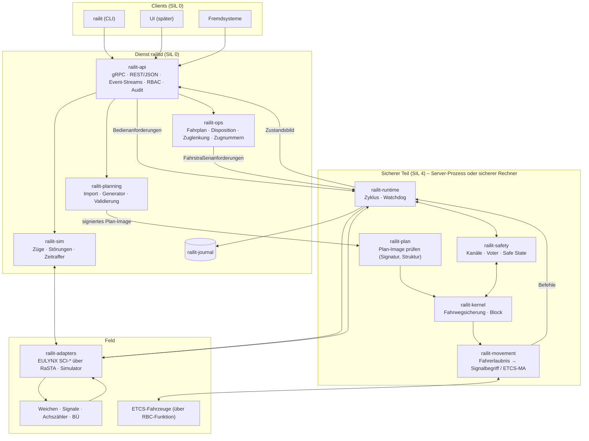
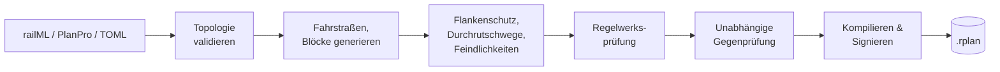
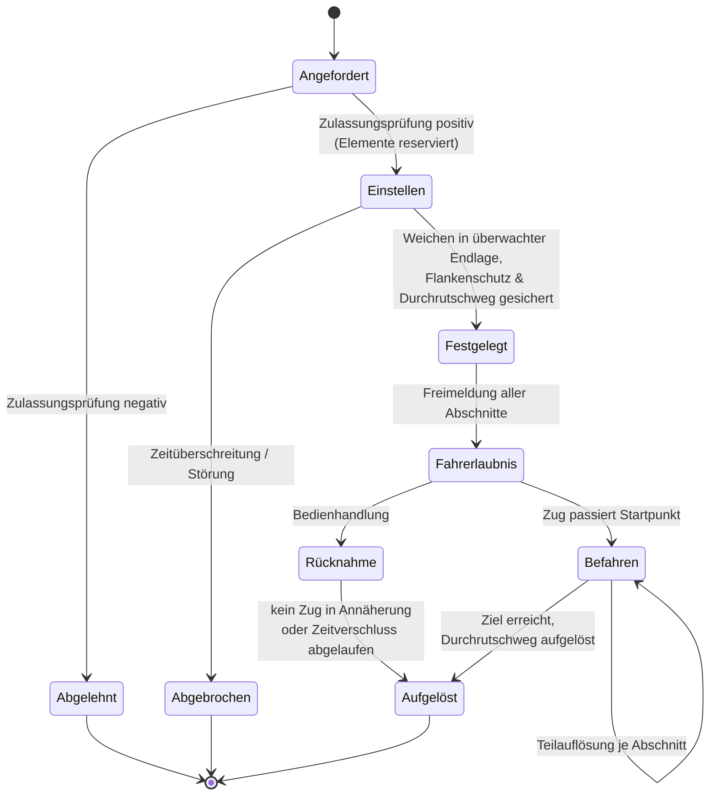

# rail-it – Konzept einer Engine für Netz- und Stellwerkmanagement

> Status: **v0.3** (Phase 1 umgesetzt) · Sprache der Implementierung: **Rust** · Lizenz: **NCSL v1.0**
>
> v0.2 arbeitet die Grundsatzentscheidungen aus Abschnitt 2 ein: vollständiger Netz- und
> Bahnbetrieb, deutsches ESTW **und** europäisches System (ETCS/EULYNX), Server **und**
> Embedded, API-first-Dienst mit CLI.

---

## 1. Zielbild

**rail-it** ist eine in Rust geschriebene Engine für den **vollständigen Betrieb eines
Schienennetzes**. Sie umfasst vier Ebenen:

1. **Netzmanagement:** ein exaktes, maschinenlesbares Modell der Infrastruktur. Dazu gehören
   Gleise, Weichen, Kreuzungen, Signale, Gleisfreimeldeabschnitte, Bahnübergänge, Strecken,
   Blockabschnitte, Betriebsstellen und Stellbereiche, jeweils mit Topologie und Geometrie.
2. **Fahrwegsicherung (Stellwerk):** die sicherheitsrelevante Steuerung. Sie bildet
   Fahrstraßen, setzt Verschlüsse, sichert Flankenschutz und Durchrutschwege, löst Fahrstraßen
   auf, führt den Streckenblock und die Hilfshandlungen. Sie folgt der Logik des deutschen ESTW
   bzw. DSTW.
3. **Zugsicherung / Fahrerlaubnis:** die Übergabe der Fahrerlaubnis an den Zug. Sie geschieht
   klassisch über Lichtsignale (Ks, H/V, mit PZB) oder europäisch über **ETCS Level 2** mit
   Movement Authorities aus einem RBC.
4. **Betriebsführung:** Fahrplan, Disposition, Zuglenkung, Zugnummernmeldung und
   Zuglaufverfolgung, dazu Diagnose, Protokollierung und Auswertung.

### Qualitätsziele

| Ziel              | Was das konkret heißt |
|-------------------|------------------------|
| **Sicher**        | Jeder Zweifel führt in den restriktiven Zustand. Der sicherheitsrelevante Kern ist strikt vom Rest getrennt. Der Kern wird von Beginn an nach den Maßstäben für SIL 4 entwickelt: kein `unsafe`, keine Panics, keine dynamische Allokation. |
| **Verlässlich**   | Deterministisch: Gleiche Eingaben ergeben bitgleiche Ausgaben. Jeder Zustand lässt sich aus dem Ereignisprotokoll rekonstruieren. Redundanz ist als 2-von-2 und 2-von-3 möglich. |
| **Performant**    | Ein Zyklus des Sicherheitskerns dauert unter 1 ms bei 5 000 Elementen. Die Zulassungsprüfung einer Fahrstraße liegt im Mikrosekundenbereich. Im Zyklus wird kein Speicher allokiert. |
| **Modular**       | Klar geschnittene Crates mit einseitigen Abhängigkeiten. Der Kern kennt weder Netzwerk noch Datenbank noch Hardware. |
| **Erweiterbar**   | Regelwerke, Fahrerlaubnis-Kanäle, Elementtypen, Feldprotokolle und Importformate lassen sich über Traits austauschen, ohne den Kern anzufassen. |
| **Portabel**      | Derselbe Kern läuft auf Linux-Servern und als `no_std`-Firmware auf sicheren Mikrocontrollern. |

### Zulassungspfad

Das Ziel ist realer Betrieb. Dafür reicht gute Software allein nicht. Nötig sind außerdem ein
Sicherheitslebenszyklus nach **EN 50126 / EN 50716 / EN 50129**, sichere Hardware, eine
qualifizierte Toolchain, unabhängige Rollen für Verifikation, Validierung und Begutachtung sowie
eine Zulassung. rail-it legt deshalb **ab Phase 0** die nötigen Grundlagen an (Abschnitt 16):
Anforderungen mit IDs, eine Gefährdungsliste, Rückverfolgbarkeit und Nachweise.

Bis zu einer Zulassung ist der Einsatz auf Simulation, Ausbildung, Prüfstände und Testlabore
beschränkt. Diese Einsatzfelder sind zugleich Meilensteine auf dem Weg dorthin.

---

## 2. Getroffene Entscheidungen

| # | Frage | Entscheidung | Folgen für die Architektur |
|---|-------|--------------|----------------------------|
| E1 | Einsatzzweck | Vollständiger Netz- und Bahnbetrieb | Strecke, Block, Betriebsführung und Zugsicherung kommen in den Umfang. Der Sicherheitslebenszyklus beginnt sofort. |
| E2 | Regelwerk | Deutsches ESTW/DSTW **und** europäisches System | Zwischen Fahrwegsicherung und Signalisierung liegt eine Fahrerlaubnis-Abstraktion (Abschnitt 9). Regelwerke: `de-estw`, `etcs`. Feldanbindung nach EULYNX. |
| E3 | Datenformat | railML 3 für den Austausch, PlanPro als deutscher Import, eigenes TOML für Tests und Beispiele, signiertes Binär-Image für den Kern | Siehe Abschnitt 6 |
| E4 | Plattform | Linux-Server **und** Embedded | Kern ist `no_std` ohne `alloc`. Der Plan wird ohne Kopie direkt aus dem Speicher gelesen. Zustandspuffer stellt der Aufrufer (Abschnitt 13). |
| E5 | Bedienung | Zuerst Dienst mit umfassender API und CLI, später UI | API-first mit Protobuf/gRPC als Vertrag. Die CLI ist ein API-Client. Eine UI kommt später als weiterer Client dazu (Abschnitt 14). |
| E6 | Lizenz | Eigene Lizenz: **Non-Commercial Source License (NCSL) v1.0** | Nur Abhängigkeiten mit freizügigen Lizenzen; Copyleft ist ausgeschlossen und wird per `cargo-deny` erzwungen. Cargo nutzt `license-file`. |

---

## 3. Architekturprinzipien

1. **Functional Core, Imperative Shell.** Der Kern ist eine reine Zustandsmaschine:
   `(Zustand, Eingaben, Zeit) → (neuer Zustand, Befehle)`. Er führt keine I/O aus, liest keine
   Uhr und allokiert nichts.
2. **Fail-safe über das Typsystem.** Nur ein positiv bestätigter Zustand gilt als sicher.
   `Occupancy::Disturbed` behandelt die Logik wie „besetzt“. Eine Weiche ohne überwachte Endlage
   ist „nicht in Lage“.
3. **Daten statt Code.** Die Anlage wird projektiert, nicht programmiert. Der Kern ist generisch
   und arbeitet auf geprüften Projektierungsdaten.
4. **Einseitige Abhängigkeiten.** Sicherheitsrelevante Crates hängen nie von nicht
   sicherheitsrelevanten ab. Betriebsführung, API und UI stellen nur *Anforderungen*. Befehle an
   Feldelemente und Fahrerlaubnisse erzeugt ausschließlich der Kern.
5. **Event Sourcing.** Jede Eingabe wird vor der Verarbeitung protokolliert. Das ermöglicht
   Replay, Störungsanalyse, Redundanzabgleich und Regressionstests mit Realdaten.
6. **Explizite Zustände.** Es gibt keinen versteckten oder globalen Zustand. Der Kernzustand
   lässt sich hashen, vergleichen und als Snapshot sichern.
7. **Partitionierung statt Locks.** Ein großes Netz besteht aus vielen Stellbereichen mit je
   einem eigenen, single-threaded Kern. Sie kommunizieren über definierte Schnittstellen.

---

## 4. Systemüberblick



**Datenfluss in einem Zyklus**

1. Adapter und API legen ihre Eingaben in einen begrenzten Eingangspuffer.
2. Die Runtime schließt den Zyklus. Sie stempelt die Eingaben mit der Zeit, schreibt sie ins
   Journal und übergibt sie geordnet an den Kern.
3. Der Kern berechnet Zustand, Stellbefehle und Fahrerlaubnisse, bei Redundanz auf allen Kanälen.
4. Der Voter vergleicht die Ergebnisse. Bei einer Abweichung geht das System in den sicheren
   Zustand.
5. Die Befehle gehen an die Adapter, das Zustandsbild an API und Betriebsführung.

---

## 5. Modulschnitt (Cargo-Workspace)

```
rail-it/
├── Cargo.toml                  # Workspace, gemeinsame Lints & Profile
├── crates/
│   ├── railit-types/           # IDs, Einheiten, Zeit, Bitsets                 SIL 4 · no_std
│   ├── railit-topology/        # Infrastrukturgraph, Navigation, Validierung    SIL 4 · no_std + alloc
│   ├── railit-plan/            # Plan-Image: Format, Zero-Copy-Sicht, Prüfung   SIL 4 · no_std
│   ├── railit-rules/           # RuleSet-Trait, de-estw, etcs                   SIL 4 · no_std
│   ├── railit-kernel/          # Fahrwegsicherung, Streckenblock                SIL 4 · no_std
│   ├── railit-movement/        # Fahrerlaubnis → Lichtsignal / ETCS-MA          SIL 4 · no_std
│   ├── railit-safety/          # Kanäle, Voter, Watchdog, Safe State            SIL 4 · no_std
│   ├── railit-runtime/         # Zyklussteuerung (std und Embedded-Variante)    SIL 4
│   ├── railit-planning/        # Fahrstraßengenerator, Validierung, Signierung  SIL 0 (+ unabh. Prüfer)
│   ├── railit-import/          # railML 3, PlanPro, rail-it-TOML                SIL 0
│   ├── railit-journal/         # Event-Log, Hash-Kette, Snapshots, Replay       SIL 0 (Diagnose)
│   ├── railit-adapters/        # eulynx/, rasta/, sim/                          SIL 4 (RaSTA) / 0
│   ├── railit-ops/             # Fahrplan, Disposition, ARS, Zugnummern         SIL 0
│   ├── railit-sim/             # Zugbewegung, Gleisfreimeldung, Fehlerinjektion SIL 0
│   ├── railit-proto/           # Protobuf-Verträge der API (railit.v1)
│   └── railit-api/             # gRPC/REST-Server, AuthN/Z, Audit               SIL 0
├── apps/
│   ├── railitd/                # Dienst
│   └── railit/                 # CLI
├── examples/                   # Beispielnetze (TOML)
├── tests/scenarios/            # Deklarative Betriebsszenarien
└── docs/
    ├── KONZEPT.md
    ├── requirements/           # Anforderungen mit IDs
    └── safety/                 # Gefährdungsliste, Sicherheitsnachweis
```

**Abhängigkeitsregel** (die CI prüft sie):

```
types ← topology ← plan ← rules ← kernel ← movement ← safety ← runtime ← {api, ops, adapters}
                     ↑
               planning ← import
```

Crates mit SIL 4 dürfen nur von Crates mit SIL 4 abhängen. Externe Abhängigkeiten sind dort
auf ein Minimum beschränkt und werden einzeln begründet.

---

## 6. Datenformate

| Zweck | Format | Begründung |
|-------|--------|------------|
| Austausch Infrastruktur, Stellwerk, Fahrplan | **railML 3.x** | Europäischer Standard. Deckt Infrastruktur, Interlocking und Fahrplan ab und ist mit RailTopoModel kompatibel. |
| Deutsche Projektierungsdaten | **PlanPro** (Import) | Datenmodell der DB für ESTW- und DSTW-Planung. Ohne PlanPro gibt es keine realen deutschen Anlagen. |
| Handgeschriebene Netze, Tests, Beispiele | **rail-it-TOML** | railML ist zu ausführlich, um Testfälle von Hand zu schreiben. Das TOML ist kompakt, gut zu diffen und gut zu reviewen. |
| Eingabe des Kerns | **Plan-Image `.rplan`** | Eigenes Binärformat mit Versionsheader, Hash und Ed25519-Signatur. Wird ohne Kopie gelesen und funktioniert auf Embedded ohne Parser. |
| API | **Protobuf** (gRPC) und JSON-Abbildung | Typsicherer, versionierter Vertrag mit generierbaren Clients in allen Sprachen. |
| Journal | Eigenes Binärformat, append-only | Hash-Kette, schnelles Replay |

Die Formate unterscheiden sich, das Modell dahinter ist eines: Alle Importer erzeugen dieselbe
interne `Topology`, aus der `railit-planning` das Plan-Image kompiliert.

---

## 7. Netzmodell (`railit-topology`)

### 7.1 Modellierung

Das Modell lehnt sich an **RailTopoModel / railML 3** und **EULYNX/PlanPro** an, ist aber auf
Rechenzeit optimiert.

- **Knoten mit Ports:** Jedes Element hat benannte Anschlüsse. Ein Gleisabschnitt hat `A`/`B`,
  eine Weiche `Spitze`/`Links`/`Rechts`, ein Prellbock nur `A`.
- **Verbindungen zwischen Ports:** Kanten verbinden Ports, nicht Elemente. Dadurch ist die
  Fahrtrichtung durch eine Weiche eindeutig, und unzulässige Wege (etwa Links → Rechts) sind
  schon strukturell ausgeschlossen.
- **Punktobjekte** (Signale, Achszählpunkte, Isolierstöße, Gleissperren, ETCS-Balisen, Tafeln)
  liegen mit Position und Wirkrichtung auf einem Gleisabschnitt.
- **Logische Ebenen** liegen darüber: Gleisfreimeldeabschnitte (TVD), Blockabschnitte,
  Strecken, Betriebsstellen, Stellbereiche und ETCS-Bereiche.

### 7.2 Speicherlayout

```rust
/// Typsichere Indizes statt Referenzen oder Rc<RefCell<..>>.
pub struct PointId(u32);

pub struct Topology {
    tracks:  Vec<Track>,        // Arena, Index = TrackId
    points:  Vec<Point>,
    signals: Vec<Signal>,
    tvds:    Vec<TvdSection>,
    links:   Vec<Link>,          // Port ↔ Port
    names:   NameIndex,          // fachliche ID ("W12") ↔ Index
}
```

Arenen mit `u32`-Indizes sind cachefreundlich, kommen ohne Referenzzählen aus und lassen sich
direkt in das Plan-Image kompilieren. Nach dem Laden ist die Topologie unveränderlich.

### 7.3 Validierung

Vor jeder Verwendung wird geprüft:

- Alle Namen sind eindeutig.
- Kein Port ist offen (außer an der Netzgrenze), keiner doppelt verbunden.
- Jedes Punktobjekt liegt innerhalb seines Gleises.
- Die Gleisfreimeldeabschnitte decken das Netz lückenlos und überlappungsfrei ab.
- Jede Weiche liegt in genau einem TVD-Abschnitt.

---

## 8. Projektierung (`railit-planning`, `railit-plan`)



Pro Fahrstraße enthält der Plan:

- Start- und Ziel sowie die Art (Zug- oder Rangierstraße),
- die Weichenlagen,
- die TVD-Abschnitte in Fahrreihenfolge,
- die Durchrutschwege,
- die Flankenschutzelemente,
- die feindlichen Fahrstraßen,
- das Geschwindigkeitsprofil.

Alle Mengen werden zu **Bitsets fester Breite** kompiliert. Eine Feindlichkeitsprüfung besteht
dann aus wenigen `AND`-Operationen.

Der Generator gilt als nicht sicherheitsrelevant. Deshalb prüft ein **unabhängiger Prüfer**
seine Ergebnisse: eine zweite Implementierung mit anderen Algorithmen. Nur übereinstimmende Pläne
werden signiert. Eine Aktivierung im Betrieb erfordert zwei Personen.

---

## 9. Fahrerlaubnis-Abstraktion: ESTW und ETCS in einem Kern

Damit das deutsche und das europäische System nebeneinander funktionieren, trennt rail-it zwei
Fragen:

- **Was ist sicher?** Diese Frage beantwortet die Fahrwegsicherung (`railit-kernel`). Sie
  liefert eine abstrakte **Fahrerlaubnis**: von wo bis wo der Fahrweg gesichert ist, mit welchem
  Gefahrpunkt, welchem Durchrutschweg und welchem Geschwindigkeitsprofil.
- **Wie erfährt es der Zug?** Diese Frage beantwortet `railit-movement`. Es übersetzt die
  Fahrerlaubnis über einen *Kanal* in Signalbegriffe oder Movement Authorities.

```rust
pub struct MovementPermission {
    pub route: RouteId,
    pub start: SignalId,              // bzw. ETCS-Halt-Tafel / Marker
    pub end_of_authority: Location,
    pub danger_point: Location,
    pub overlap: Option<OverlapId>,
    pub speed_profile: SpeedProfileRef,
}

pub trait SignallingChannel {
    /// Fahrerlaubnisse dieses Zyklus → kanalspezifische Befehle.
    fn render(&mut self, permissions: &[MovementPermission], out: &mut CommandBuffer);
}
```

| Kanal | Ausgabe | Regelwerk |
|-------|---------|-----------|
| `lineside::ks` | Ks-Signalbegriffe, Zusatzanzeiger (Zs3/Zs3v), PZB-Wirkung | `de-estw` |
| `lineside::hv` | H/V-Signalbegriffe, PZB-Wirkung | `de-estw` |
| `etcs::l2` | Movement Authorities (EoA, Danger Point, Overlap, statisches Geschwindigkeitsprofil) an die RBC-Funktion | `etcs` |

Ein Abschnitt kann **mehrere Kanäle zugleich** haben, etwa ETCS Level 2 mit Lichtsignalen als
Rückfallebene. Das ist im Mischbetrieb der Normalfall. Für ETCS mit Moving Block bzw. Hybrid
Level 3 ist das Konzept der *Virtual Sub-Sections* (VSS) vorgesehen: Belegung entsteht dann
aus der Gleisfreimeldung **und** aus Positionsmeldungen der Züge.

---

## 10. Fahrwegsicherung (`railit-kernel`)

### 10.1 Schnittstelle

```rust
#![no_std]
#![forbid(unsafe_code)]

pub struct Interlocking<'p, R: RuleSet> {
    plan:  PlanView<'p>,           // geprüftes Plan-Image, zero-copy
    rules: R,
    state: KernelState<'p>,        // Puffer vom Aufrufer, Größe aus dem Plan-Header
}

impl<'p, R: RuleSet> Interlocking<'p, R> {
    /// Ein Zyklus. Keine I/O, keine Uhr, keine Allokation, keine Panics.
    pub fn step(&mut self, now: Tick, inputs: &[Input], out: &mut Outputs)
        -> Result<StepReport, SafeStateReason>;
}
```

`Input` umfasst Element-Meldungen (Weiche, Signal, TVD, BÜ), Bedienanforderungen, bestätigte
Hilfshandlungen, Meldungen der Nachbarstellwerke und Heartbeats. `Outputs` enthält Stellbefehle
und Fahrerlaubnisse.

### 10.2 Fahrstraßen-Lebenszyklus



### 10.3 Regeln, die in jedem Zyklus gelten

- **Fahrerlaubnis nur bei vollständiger Sicherung.** Entfällt eine Bedingung, wird die
  Fahrerlaubnis sofort zurückgenommen. Das Signal fällt auf Halt, oder die MA wird verkürzt.
- **Verschluss:** Elemente einer festgelegten Fahrstraße lassen sich nicht umstellen.
- **Auflösung nur durch den Zug oder unter Zeitverschluss.** Alles andere ist eine
  zählpflichtige Hilfshandlung.
- **Kommunikationsverlust** zu einem Element bedeutet: gestört, also restriktiv.

### 10.4 Netz: Strecke, Block, Nachbarstellwerke

- **Streckenblock:** Blockabschnitte zwischen Betriebsstellen werden wie Fahrstraßen
  behandelt, mit Erlaubnis- und Gleisfreimeldung im Sinne eines Zentralblocks.
- **Nachbarstellwerke:** Jeder Stellbereich hat einen eigenen Kern. An den Grenzen tauschen
  sie Zustimmungen, Belegungen und Fahrerlaubnisse aus, angelehnt an EULYNX SCI-ILS.
  Grenzüberschreitende Fahrstraßen funktionieren per Anfrage und Zustimmung.
- **Bahnübergänge:** Einschalten, Sicherung überwachen, Freigabe der Fahrerlaubnis nur bei
  gesichertem BÜ.

### 10.5 Invarianten

Nach jedem `step` prüft der Kern seine Invarianten. Eine Verletzung führt nicht zur Panik,
sondern zu `Err(SafeStateReason)` und damit in den sicheren Zustand. Beispiele:

- Kein Element ist von zwei unverträglichen Fahrstraßen belegt.
- Jede Fahrerlaubnis gehört zu genau einer festgelegten Fahrstraße.
- Jede Weiche einer festgelegten Fahrstraße ist in der geforderten Lage überwacht.
- Kein Stellbefehl geht an ein verschlossenes Element.

Die Invarianten sind die **zentrale Sicherheitsspezifikation**. Sie werden mit Property-Tests
und, wo möglich, formal mit Kani nachgewiesen.

### 10.6 Hilfshandlungen

```rust
pub struct Pending<Op>   { op: Op, requested_by: OperatorId, at: Tick }
pub struct Confirmed<Op> { op: Op, requested_by: OperatorId, confirmed_by: OperatorId, counter: u64 }
```

Der Kern nimmt nur `Confirmed<_>` an. Eine Bestätigung erfordert eine zweite, getrennte
Handlung. Jede Hilfshandlung zählt ein Zählwerk hoch und wird im Journal festgehalten.

---

## 11. Regelwerke (`railit-rules`)

Regelwerke werden **statisch** über Generics eingebunden. Code wird nie dynamisch in den Kern
nachgeladen.

```rust
pub trait RuleSet {
    fn overlap(&self, route: &RouteDef) -> OverlapRequirement;
    fn release_strategy(&self, route: &RouteDef) -> ReleaseStrategy;
    fn approach_locking(&self, route: &RouteDef) -> Duration;
    fn flank_protection(&self, ctx: &FlankContext) -> FlankRequirement;
}
```

- `de-estw`: Logik nach Ril 819, Ks- und H/V-Signale, PZB-Wirkung, Zentralblock.
- `etcs`: ETCS Level 2 nach TSI ZZS. Im Mischbetrieb wird es mit `de-estw` kombiniert.

---

## 12. Feldanbindung (`railit-adapters`)

| Adapter  | Zweck |
|----------|-------|
| `sim`    | Deterministischer In-Process-Simulator für Tests und Ausbildung |
| `eulynx` | SCI-P (Weiche), SCI-LS (Lichtsignal), SCI-TDS (Gleisfreimeldung), SCI-LX (BÜ), SCI-ILS (Nachbarstellwerk), SCI-RBC |
| `rasta`  | Sicheres Transportprotokoll RaSTA (DIN VDE V 0831-200) nach EN 50159 |

```rust
pub trait FieldAdapter: Send {
    fn submit(&mut self, cmds: &[Command]) -> Result<(), AdapterError>;
    fn drain(&mut self, sink: &mut InputSink);
    fn health(&self) -> AdapterHealth;
}
```

---

## 13. Plattformen: Server und Embedded

Damit der Kern auf beiden Plattformen läuft, gelten diese Regeln:

- `railit-types`, `railit-plan`, `railit-rules`, `railit-kernel`, `railit-movement` und
  `railit-safety` sind `#![no_std]` **ohne `alloc`**.
- Das Plan-Image wird ohne Kopie gelesen, auf Embedded direkt aus dem Flash. Beim Laden werden
  Struktur, Grenzen, Hash und Signatur geprüft.
- Den Zustandsspeicher stellt der Aufrufer. Auf Embedded sind das statische Puffer, deren
  Größe der Plan-Header vorgibt. Auf dem Server sind es `Vec`s.
- Die Runtime gibt es in zwei Varianten: `std` (Threads und Tokio für I/O) und `embedded`
  (Zyklus über einen Timer-Interrupt).

| Ziel | Target | Verwendung |
|------|--------|------------|
| Linux-Server | `x86_64-unknown-linux-gnu`, `aarch64-unknown-linux-gnu` | Gesamtsystem, Simulation, Leitstelle |
| Sicherer Rechner | `armv7r-none-eabihf` (Cortex-R, Lockstep) | Kern mit Safety in 2-von-2- oder 2-von-3-Konfiguration |
| Element-Controller | `thumbv7em-none-eabihf` (Cortex-M) | Objektcontroller, Prüfstände |

**Einsatzvarianten**

1. **Alles auf dem Server:** `railitd` mit internen Kanälen. Für Simulation, Ausbildung und
   Labor.
2. **Verteilt:** Kern und Safety laufen auf sicheren Rechnern. `railitd` läuft auf Linux mit
   Betriebsführung und API. Die Verbindung erfolgt über RaSTA.

---

## 14. Dienst, API und CLI

### 14.1 API-first

Der Vertrag ist **Protobuf** im Paket `railit.v1`, versioniert und mit Prüfung auf
Abwärtskompatibilität in der CI. Er wird auf drei Wegen angeboten:

- **gRPC** (`tonic`) als Hauptschnittstelle,
- **REST/JSON** mit generierter OpenAPI für einfache Integrationen,
- **Event-Streams** über gRPC-Server-Streaming bzw. WebSocket für Zustandsänderungen, Alarme
  und Journal.

| Service | Aufgaben |
|---------|----------|
| `InfrastructureService` | Netz, Elemente und Spurplan-Geometrie abfragen |
| `PlanningService` | Plan hochladen, validieren, kompilieren, vergleichen; Aktivierung mit zwei Personen |
| `InterlockingService` | Fahrstraßen einstellen und zurücknehmen, Elemente bedienen, Hilfshandlungen anfordern und bestätigen, Zustand abfragen |
| `OperationsService` | Züge, Zugnummern, Fahrplan, Disposition, Zuglenkung ein/aus |
| `EtcsService` | Angemeldete Züge, Movement Authorities, Positionsmeldungen |
| `SimulationService` | Zeit steuern, Züge einsetzen, Störungen injizieren |
| `EventService` | Abonnements auf Zustand, Alarme, Journal |
| `DiagnosticsService` | Health, Versionen, Metriken (zusätzlich Prometheus `/metrics`) |
| `AdminService` | Benutzer, Rollen, Schlüssel, Freigaben |

Sicherheit: mTLS, Rollen (Fahrdienstleiter, Disponent, Instandhaltung, Projektierer,
Administration, Beobachter), vollständiges Audit und ein Zonenmodell nach IEC 62443 /
CLC/TS 50701.

**Stand Phase 1:** `railitd` bietet die API `v1` zunächst als **REST/JSON** mit einem
Ereignisstrom über Server-Sent Events und einem Bearer-Token (siehe
[api.md](api.md)). Damit sind Bedienung, Zustandsbild, Ereignisse und Simulation ohne
Code-Generierung von jedem Werkzeug aus nutzbar. Der Protobuf/gRPC-Vertrag folgt in
Phase 3. Die REST-Pfade bleiben dann als JSON-Abbildung desselben Vertrags erhalten.

### 14.2 CLI `railit`

Die CLI hat zwei Betriebsarten: **offline** für Projektierung und Analyse, **online** als Client
von `railitd`.

```
# offline
railit net validate examples/beispielstadt.toml
railit net info     examples/beispielstadt.toml
railit plan compile examples/beispielstadt.toml --rules de-estw -o beispielstadt.rplan
railit plan verify  beispielstadt.rplan
railit scenario run tests/scenarios/einfahrt.toml
railit journal replay betrieb.rjl --until 2026-10-11T12:00:00Z

# online
railit route set A-N2
railit route cancel A-N2
railit state points --area beispielstadt
railit aux request hilfsaufloesung --route A-N2
railit aux confirm 42
railit watch events --filter alarms
railit sim train add --number ICE577 --at A --speed 80
```

Alle Ausgaben gibt es wahlweise als Text oder mit `--output json`, damit sich die CLI in
Skripten verwenden lässt.

### 14.3 Später: UI

Die UI ist ein weiterer API-Client, etwa eine Web-Spurplandarstellung. Ein Punkt braucht
dabei Sorgfalt: Hilfshandlungen verlangen eine **sichere Anzeige- und Bestätigungskette**, zum
Beispiel durch Rückmeldung mit Prüfcode. Die API ist darauf von Beginn an ausgelegt.

---

## 15. Zuverlässigkeit & Performance

**Redundanz**

- 2-von-2 oder 2-von-3 deterministische Kanäle. Der Voter vergleicht die Befehle und den Hash
  des Zustands.
- Optional diversitär (anderes Target, andere Optimierungsstufe).
- Ein Watchdog überwacht die Zyklus-Deadline.
- Hot Standby, indem ein zweiter Rechner das Journal mitliest.

**Neustart**

Nach einem Neustart gelten alle Elemente als unbekannt, alle Fahrerlaubnisse sind
zurückgenommen. Das Journal dient der Diagnose. Es wird nicht blind wiederhergestellt, denn
der tatsächliche Zustand draußen hat Vorrang.

**Performance**

| Kennzahl | Ziel |
|----------|------|
| Kernzyklus bei 5 000 Elementen | < 1 ms (p99) |
| Zulassungsprüfung einer Fahrstraße | < 10 µs |
| Allokationen im Kernzyklus | 0 |
| Replay von 24 h Betrieb | < 60 s |

Die Mittel dafür:

- Arenen mit `u32`-Indizes,
- Bitsets,
- Vorberechnung offline,
- inkrementelle Auswertung über einen Index von Element zu Fahrstraßen,
- Partitionierung in Stellbereiche,
- `criterion`-Benchmarks in der CI.

---

## 16. Sicherheitslebenszyklus & Qualitätssicherung

### 16.1 Prozess (EN 50126 / EN 50716 / EN 50129)

| Artefakt | Ort | Ab Phase |
|----------|-----|----------|
| Systemdefinition, Betriebsszenarien | `docs/` | 0 |
| Gefährdungsliste (Hazard Log) | `docs/safety/hazard-log.md` | 0 |
| Anforderungen mit IDs (`REQ-…`) | `docs/requirements/` | 0 |
| Rückverfolgbarkeit Anforderung → Code → Test | CI-Bericht | 1 |
| Architektur- und Modulentwürfe | `docs/` | 1 |
| Verifikations- und Validierungsberichte | CI-Artefakte | 2 |
| Sicherheitsnachweis (Safety Case) | `docs/safety/` | 5 |

**Hinweis zur Organisation:** Die Normen verlangen unabhängige Rollen für Implementierung,
Verifikation, Validierung und Begutachtung (ISA). Diese Rollen müssen vor einer Zulassung
besetzt werden.

### 16.2 Werkzeuge

| Ebene | Werkzeug |
|-------|----------|
| Lints | `clippy` mit `unwrap_used`, `expect_used`, `panic`, `indexing_slicing` und `arithmetic_side_effects` auf `deny` in allen Crates mit SIL 4 |
| Tests | `cargo test`, `proptest` (Invarianten), deklarative Szenarien |
| Formal | `kani` (Bounded Model Checking) für Invarianten und Zustandsübergänge |
| Robustheit | `cargo-fuzz` (Importer, Plan-Image, Protokolle), `cargo-mutants` |
| Lieferkette | `cargo-deny` (Lizenzen, Advisories), `cargo-audit`, SBOM, gepinnte Toolchain |
| Toolchain | Langfristig eine qualifizierte Toolchain (z. B. Ferrocene) für die Crates mit SIL 4 |

---

## 17. Lizenz und Abhängigkeiten

rail-it steht unter der **Non-Commercial Source License (NCSL) v1.0**. Nicht-kommerzielle
Nutzung ist frei. Kommerzielle Nutzung, also auch der Einsatz durch ein Eisenbahnunternehmen,
erfordert eine schriftliche Lizenz des Lizenzgebers.

Daraus folgen diese Regeln:

- **Abhängigkeiten** dürfen nur freizügige Lizenzen haben (MIT, Apache-2.0, BSD, ISC, Zlib,
  Unicode). Copyleft-Lizenzen (GPL, LGPL, AGPL) sind ausgeschlossen. `deny.toml` setzt das
  durch.
- **Beiträge Dritter** stehen nach NCSL §11.2 ebenfalls unter NCSL. Für eine spätere
  kommerzielle Doppellizenzierung empfiehlt sich ein Contributor License Agreement (CLA).
- In Cargo wird `license-file = "LICENSE"` verwendet, weil NCSL keine SPDX-Kennung hat.

---

## 18. Roadmap

| Phase | Inhalt | Ergebnis | Stand |
|-------|--------|----------|-------|
| **0 – Fundament** | Workspace, CI, Lizenz, `types`, `topology`, rail-it-TOML, `railit net validate/info`, erste Gefährdungsliste und Anforderungen | Netz laden, prüfen und beschreiben | ✔ |
| **1 – Minimaler Kern** | Plan-Image (signiert), Fahrstraßengenerator mit unabhängiger Gegenprüfung, Kern mit Weichen, Signalen und TVD inkl. Teilauflösung und Zeitverschluss, Simulator, Szenarien, `railitd` mit REST-API, CLI | Bahnhof „Beispielstadt“ (`examples/beispielstadt.toml`) fährt sicher in der Simulation, bedienbar über die CLI | ✔ |
| **2 – ESTW vollständig** | Durchrutschwege, Flankenschutz, Hilfshandlungen mit Zählwerk, Signalbegriffe Ks und H/V (`railit-movement`), BÜ, Erkennung unerlaubter Besetzungen, Journal und Replay | Fachlich vollständiges Einzelstellwerk nach `de-estw` | offen |
| **3 – Netz & Betrieb** | Mehrere Stellbereiche, Streckenblock, Zugnummern, Fahrplan, Zuglenkung, Disposition, gRPC-Vertrag, Rollen, mTLS, Audit | Betrieb eines Netzes mit mehreren Bahnhöfen in der Simulation | offen |
| **4 – Europa** | ETCS Level 2 (MA-Erzeugung, RBC-Funktion), EULYNX SCI-* über RaSTA, Import von railML 3 und PlanPro | Mischbetrieb ESTW/ETCS, Anbindung an Prüfstände | offen |
| **5 – Sicherheit & Embedded** | Redundante Kanäle, Voter, Cortex-R-Runtime, Kani-Nachweise, Fuzzing, Safety Case | Zulassungsreifer Kandidat für das Labor | offen |
| **6 – UI** | Spurplan-UI als API-Client mit sicherer Anzeige- und Bestätigungskette | Bedienplatz | offen |

**Umgesetzte Crates (Stand Phase 1):** `railit-types`, `railit-topology`, `railit-plan`,
`railit-planning`, `railit-rules`, `railit-kernel`, `railit-sim`, `railit-runtime`
(einschließlich Szenario-Runner und Schlüsselverwaltung), `railit-import` sowie die
Anwendungen `railit` und `railitd`. Die übrigen Crates aus Abschnitt 5 entstehen in den
jeweiligen Phasen.

---

## 19. Noch offene Punkte

1. **Lizenzangaben:** Der Kontakt für kommerzielle Lizenzen ist support@josunlp.de.
   Anwendbares Recht (Deutschland) und Gerichtsstand (Norderstedt) sind vorbelegt und noch
   zu bestätigen.
2. **Konkrete Embedded-Hardware** für den sicheren Rechner (wichtig ab Phase 5).
3. **Besetzung der unabhängigen Rollen** (Verifikation, Validierung, ISA) mit Blick auf eine
   spätere Zulassung.
4. **Beitragsmodell:** CLA ja oder nein.
