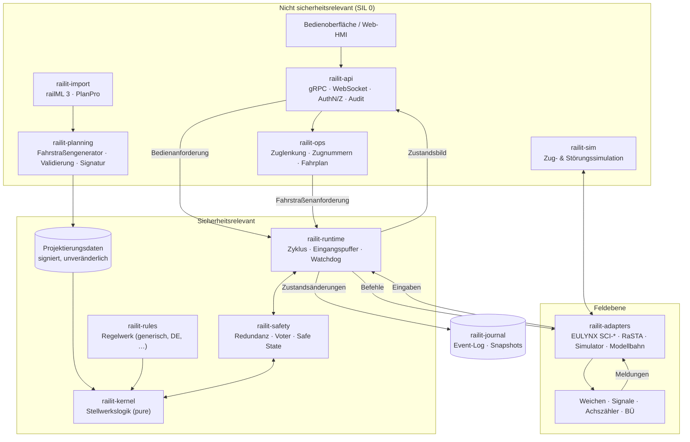
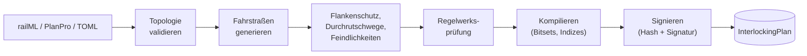
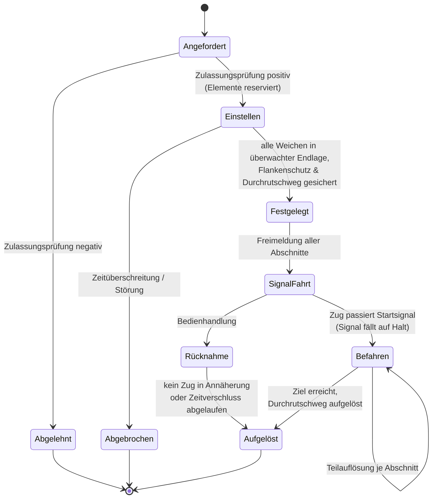

# rail-it – Konzept einer Engine für Netz- und Stellwerkmanagement

> Status: **Entwurf v0.1** · Sprache der Implementierung: **Rust** · Lizenz: GPL-3.0

---

## 1. Zielbild

**rail-it** ist eine in Rust geschriebene Engine, die drei Aufgaben vereint:

1. **Netzmanagement** – ein exaktes, maschinenlesbares Modell der Eisenbahninfrastruktur
   (Gleise, Weichen, Kreuzungen, Signale, Gleisfreimeldeabschnitte, Bahnübergänge,
   Stellbereiche) inklusive Topologie, Geometrie und Betriebsstellen.
2. **Stellwerkslogik** – die sicherheitsrelevante Steuerung: Fahrstraßenbildung,
   Verschlüsse, Flankenschutz, Durchrutschwege, Signalbegriffe, Fahrstraßenauflösung,
   Hilfshandlungen.
3. **Betriebsführung** – die nicht sicherheitsrelevante Ebene darüber: Zugnummernmeldung,
   automatische Zuglenkung, Konflikterkennung, Bedienoberflächen, Protokollierung.

### Qualitätsziele

| Ziel              | Was das konkret heißt |
|-------------------|------------------------|
| **Sicher**        | Jeder Zweifel führt in den restriktiven Zustand (Signal „Halt“). Strikte Trennung von sicherheitsrelevantem Kern und allem anderen. Kein `unsafe`, keine Panics im Kern. |
| **Verlässlich**   | Deterministisch: gleiche Eingaben ⇒ bitgleiche Ausgaben. Vollständig rekonstruierbar aus Ereignisprotokoll. Redundanzfähig (2-von-2 / 2-von-3). |
| **Performant**    | Sicherheitskern-Zyklus < 1 ms für 5 000 Elemente, Fahrstraßen-Zulassungsprüfung im Mikrosekundenbereich, keine Allokation im Zyklus. |
| **Modular**       | Klar geschnittene Crates mit einseitigen Abhängigkeiten. Kern kennt weder Netzwerk, Datenbank noch Hardware. |
| **Erweiterbar**   | Nationale Regelwerke, Elementtypen, Feldschnittstellen und Importformate sind austauschbar über Traits – ohne den Kern anzufassen. |

### Ehrliche Abgrenzung

Software allein macht kein zulassungsfähiges Stellwerk. Ein Einsatz im realen Bahnbetrieb
erfordert einen Entwicklungsprozess nach **EN 50126 / EN 50716 (Nachfolger von EN 50128) /
EN 50129**, sichere Hardware, eine qualifizierte Toolchain und eine unabhängige Begutachtung.
rail-it wird deshalb so gebaut, dass dieser Weg **offen bleibt** (Architektur, Nachweisbarkeit,
Rückverfolgbarkeit), zielt aber zunächst auf:

- Simulation, Ausbildung und Forschung,
- Testumgebungen und Prüfstände (z. B. Gegenstück für Stellwerkstests),
- Modellbahn- und Lehranlagen.

---

## 2. Architekturprinzipien

1. **Functional Core, Imperative Shell.** Der Stellwerkskern ist eine reine Zustandsmaschine:
   `(Zustand, Eingaben, Zeit) → (neuer Zustand, Befehle)`. Er liest keine Uhr, öffnet keine
   Sockets, allokiert nicht. Alles „Schmutzige“ lebt in der Hülle.
2. **Fail-safe per Typsystem.** Zustände, die nicht *positiv* als sicher bestätigt sind,
   werden wie der ungünstigste Fall behandelt. `Occupancy::Disturbed` ist für die Logik
   gleichbedeutend mit „besetzt“, eine Weiche ohne überwachte Endlage ist „nicht in Lage“.
3. **Daten vor Code.** Die Stellwerkslogik wird nicht pro Bahnhof programmiert, sondern
   aus geprüften **Projektierungsdaten** (Fahrstraßentabelle, Flankenschutz, Durchrutschwege)
   generiert. Der Kern ist generisch, die Anlage ist Konfiguration.
4. **Einseitige Abhängigkeiten.** Sicherheitsrelevante Crates hängen nie von nicht
   sicherheitsrelevanten ab. Die Betriebsführung darf nur *Anforderungen* stellen –
   Befehle an Feldelemente erzeugt ausschließlich der Kern.
5. **Event Sourcing.** Jede Eingabe wird vor der Verarbeitung protokolliert. Damit sind
   Replay, Störungsanalyse, Redundanzabgleich und Regressionstests aus Realbetrieb möglich.
6. **Explizite Zustände.** Kein versteckter Zustand, keine globalen Variablen. Der gesamte
   Kernzustand ist `Clone + Eq + Hash` und kann gehasht, verglichen und gesnapshottet werden.

---

## 3. Systemüberblick



**Datenfluss in einem Zyklus**

1. Adapter und API legen Eingaben in einen begrenzten, lock-freien Eingangspuffer.
2. Die Runtime schließt den Zyklus: Eingaben werden zeitgestempelt, ins Journal geschrieben
   und als geordnete Liste dem Kern übergeben.
3. Der Kern berechnet neuen Zustand und Befehle (bei Redundanz: auf allen Kanälen).
4. Der Voter vergleicht die Ergebnisse; bei Abweichung → sicherer Zustand.
5. Befehle gehen an die Adapter, das Zustandsbild an API/HMI.

---

## 4. Modulschnitt (Cargo-Workspace)

```
rail-it/
├── Cargo.toml                  # Workspace, gemeinsame Lints & Profile
├── crates/
│   ├── railit-types/           # IDs, Einheiten, Tick/Zeit, Bitsets, Fehler   (no_std)
│   ├── railit-topology/        # Infrastrukturgraph, Navigation, Geometrie    (no_std + alloc)
│   ├── railit-plan/            # Datenstrukturen der Projektierung            (no_std)
│   ├── railit-planning/        # Generator, Validierung, Signierung der Projektierung
│   ├── railit-rules/           # Regelwerk-Trait + Implementierungen          (no_std)
│   ├── railit-kernel/          # Sicherheitskern Stellwerkslogik              (no_std, forbid(unsafe))
│   ├── railit-safety/          # Redundanzkanäle, Voter, Watchdog, Safe State
│   ├── railit-runtime/         # Zyklussteuerung, Eingangspuffer, Shell um den Kern
│   ├── railit-journal/         # Append-only Event-Log, Hash-Kette, Snapshots, Replay
│   ├── railit-elements/        # Element-Meldungen/-Befehle, Treiber-Traits
│   ├── railit-adapters/        # eulynx/, rasta/, sim/, modelrail/ (Feature-Flags)
│   ├── railit-ops/             # Zuglenkung (ARS), Zugnummernmeldung, Konflikterkennung
│   ├── railit-sim/             # Zugbewegung, Gleisfreimeldung, Fehlerinjektion
│   ├── railit-import/          # railML 3.x, PlanPro, eigenes TOML-Format
│   └── railit-api/             # gRPC/WebSocket, RBAC, Audit
├── apps/
│   ├── railit-server/          # Gesamtsystem als Dienst
│   ├── railit-cli/             # Projektierung prüfen, Replay, Szenarien ausführen
│   └── railit-hmi/             # Web-Bedienoberfläche (Spurplandarstellung)
├── tests/scenarios/            # Deklarative Betriebsszenarien
└── docs/
```

**Abhängigkeitsregel** (wird per CI geprüft, z. B. mit `cargo-deny` / eigenem Check):

```
types ← topology ← plan ← rules ← kernel ← safety ← runtime ← {api, ops, adapters}
                     ↑
                 planning ← import
```

Der Kern (`railit-kernel`) hängt nur von `types`, `plan` und `rules` ab und hat **keine**
externen Abhängigkeiten außer evtl. `heapless`. Je kleiner der Kern, desto leichter Nachweis
und Begutachtung.

---

## 5. Netzmodell (`railit-topology`)

### 5.1 Modellierung

Angelehnt an **RailTopoModel / railML 3** und **EULYNX/PlanPro**, aber für Rechenzeit optimiert:

- **Knoten mit Ports:** Jedes Element (Gleisabschnitt, Weiche, Kreuzung, Prellbock) hat
  benannte Anschlüsse. Ein Gleis hat `A`/`B`, eine Weiche `Spitze`/`Links`/`Rechts`,
  eine Kreuzungsweiche vier Ports mit erlaubten Fahrwegen.
- **Kanten verbinden Ports**, nicht Elemente. Damit ist die Fahrtrichtung beim Durchlaufen
  einer Weiche eindeutig, und unzulässige Wege (z. B. Links → Rechts) sind strukturell
  ausgeschlossen.
- **Punktobjekte** (Signale, Achszählpunkte, Isolierstöße, Gleissperren, Tafeln) liegen mit
  Position und Wirkrichtung auf einem Gleisabschnitt.
- **Logische Ebenen** darüber: Gleisfreimeldeabschnitte (TVD), Stellbereiche,
  Betriebsstellen, Bahnsteige.

### 5.2 Speicherlayout

```rust
/// Typsichere Indizes statt Referenzen oder Rc<RefCell<..>>.
#[derive(Copy, Clone, Eq, PartialEq, Hash, Ord, PartialOrd)]
pub struct PointId(u32);

pub struct Topology {
    tracks:   Vec<Track>,        // Arena, Index = TrackId
    points:   Vec<Point>,        // Arena, Index = PointId
    signals:  Vec<Signal>,
    tvds:     Vec<TvdSection>,
    links:    Vec<Link>,         // Port ↔ Port
    // vorberechnete Nachbarschaftslisten (CSR) für schnelle Navigation
    adjacency: CsrGraph<PortRef>,
}
```

- Arenen + `u32`-Indizes ⇒ cachefreundlich, kein Referenzzählen, trivial serialisierbar.
- Nach dem Laden **unveränderlich**; Änderungen erzeugen eine neue, neu validierte Version.
- Identität über stabile, fachliche IDs (z. B. `"W12"`, `"N3"`) – intern auf Indizes gemappt.

### 5.3 Validierung beim Laden

Bevor eine Topologie verwendet wird, prüft `railit-planning` u. a.: Zusammenhang,
keine offenen Ports (außer Prellbock/Netzgrenze), konsistente Wirkrichtungen,
Gleisfreimeldeabschnitte lückenlos und überlappungsfrei, jedes Signal hat einen
erreichbaren Zielpunkt, Weichen liegen vollständig in einem TVD-Abschnitt.

---

## 6. Projektierung (`railit-plan`, `railit-planning`)

Die Projektierung übersetzt das Netz in die Tabellen, mit denen der Kern arbeitet –
das Äquivalent zur Fahrstraßen- und Verschlusstabelle.



Pro Fahrstraße enthält der `InterlockingPlan`:

- Start- und Zielsignal, Art (Zug-/Rangierstraße),
- erforderliche Weichenlagen und Gleissperren,
- befahrene TVD-Abschnitte in Reihenfolge (für Teilauflösung),
- zulässige Durchrutschwege mit ihren Elementen,
- Flankenschutzelemente (direkt und mittelbar über Flankenschutz-Transport),
- feindliche Fahrstraßen,
- Signalbegriffsregeln (Geschwindigkeiten, Vorsignalisierung) des Regelwerks.

Alle Mengen werden zu **Bitsets fester Breite** kompiliert. Eine Feindlichkeitsprüfung
ist damit eine Handvoll `AND`-Operationen über `u64`-Wörter.

**Doppelte Absicherung:** Der Generator ist nicht sicherheitsrelevant entwickelt. Sein
Ergebnis wird deshalb von einem **unabhängigen Prüfer** (zweite Implementierung, andere
Algorithmen) gegengeprüft. Nur übereinstimmende Pläne werden signiert. Der Kern lädt
ausschließlich signierte Pläne und prüft Signatur und Versionskompatibilität beim Start.

---

## 7. Sicherheitskern (`railit-kernel`)

### 7.1 Schnittstelle

```rust
#![no_std]
#![forbid(unsafe_code)]

pub struct Interlocking<'p, R: RuleSet> {
    plan:  &'p InterlockingPlan,   // geprüft, signiert, unveränderlich
    rules: R,
    state: KernelState,            // vollständig, Clone + Eq + Hash
}

impl<'p, R: RuleSet> Interlocking<'p, R> {
    /// Ein Zyklus. Keine I/O, keine Uhr, keine Allokation, keine Panics.
    pub fn step(
        &mut self,
        now: Tick,
        inputs: &[Input],
        out: &mut CommandBuffer,
    ) -> Result<StepReport, SafeStateReason>;
}

pub enum Input {
    PointReport  { id: PointId,  status: PointStatus },   // Endlage überwacht / keine Endlage / gestört
    TvdReport    { id: TvdId,    status: Occupancy },     // frei / besetzt / gestört
    SignalReport { id: SignalId, status: SignalStatus },  // Begriff bestätigt / Lampenfehler / …
    Request(OperatorRequest),                             // Fahrstraße einstellen, auflösen, …
    AuxRequest(Confirmed<AuxOperation>),                  // zählpflichtige Hilfshandlung
    Heartbeat    { element: ElementRef },
}

pub enum Command {
    MovePoint   { id: PointId,  to: PointPosition },
    ShowAspect  { id: SignalId, aspect: Aspect },
    LevelCrossing { id: LxId, cmd: LxCommand },
}
```

### 7.2 Fahrstraßen-Lebenszyklus



Zentrale Regeln, die der Kern in **jedem** Zyklus durchsetzt:

- **Signalhaltfall:** Ein Signal zeigt nur Fahrt, solange *alle* Bedingungen der
  Fahrstraße gelten (Weichen überwacht, Abschnitte frei, Flankenschutz, Durchrutschweg,
  Nachbarstellwerk-Zustimmung). Fällt eine weg → sofort Halt.
- **Verschluss:** Elemente einer festgelegten Fahrstraße lassen sich nicht umstellen;
  jede Anforderung dazu wird abgewiesen.
- **Auflösung nur zugbewirkt oder unter Zeitverschluss**; manuelle Auflösung belegter
  Elemente nur als zählpflichtige Hilfshandlung.
- **Kommunikationsverlust** zu einem Element (fehlender Heartbeat) ⇒ Element gilt als
  gestört ⇒ betroffene Signale auf Halt.

### 7.3 Invarianten

Nach jedem `step` werden Invarianten geprüft; eine Verletzung führt nicht zur Panik,
sondern zu `Err(SafeStateReason)` und damit zum sicheren Zustand (alle Signale Halt,
keine Stellbefehle, Alarm). Beispiele:

- Kein Element ist von zwei nicht verträglichen Fahrstraßen gleichzeitig belegt.
- Ein Fahrt zeigendes Signal hat genau eine festgelegte Fahrstraße.
- Jede Weiche in einer festgelegten Fahrstraße ist in überwachter, geforderter Endlage.
- Kein Stellbefehl an ein verschlossenes Element.

Dieselben Invarianten werden in Tests (Property-Based) und, wo möglich, formal (Kani)
nachgewiesen – sie sind die **zentrale Sicherheitsspezifikation** des Projekts.

### 7.4 Hilfshandlungen

Hilfshandlungen (z. B. Hilfsauflösung, Ersatzsignal, Achszähl-Grundstellung,
Weichenumstellung unter Belegung) sind über das Typsystem abgesichert:

```rust
pub struct Pending<Op>  { op: Op, requested_by: OperatorId, at: Tick }
pub struct Confirmed<Op> { op: Op, requested_by: OperatorId, confirmed_by: OperatorId, counter: u64 }

impl<Op: AuxOperation> Pending<Op> {
    /// Nur über eine zweite, getrennte Bestätigung erreichbar.
    pub fn confirm(self, by: OperatorId, at: Tick, ctr: &mut AuxCounter) -> Result<Confirmed<Op>, AuxError>;
}
```

Der Kern akzeptiert nur `Confirmed<_>`. Jede Hilfshandlung erhöht ein Zählwerk und wird
unveränderlich im Journal protokolliert.

---

## 8. Regelwerke (`railit-rules`)

Unterschiedliche Bahnen, unterschiedliche Regeln. Der Kern bleibt generisch; Abweichungen
stecken in einem Trait, der **statisch** (Generics) eingebunden wird – kein dynamisches
Nachladen von Code in den Sicherheitskern.

```rust
pub trait RuleSet {
    /// Welcher Signalbegriff ergibt sich aus Fahrstraße, Folgesignal und Geschwindigkeiten?
    fn aspect(&self, ctx: &AspectContext) -> Aspect;
    /// Wann ist ein Durchrutschweg erforderlich und wie lang?
    fn overlap(&self, route: &RouteDef) -> OverlapRequirement;
    /// Teilauflösung je Abschnitt oder Gesamtauflösung?
    fn release_strategy(&self, route: &RouteDef) -> ReleaseStrategy;
    /// Zeitverschluss bei Fahrstraßenrücknahme.
    fn approach_locking(&self, route: &RouteDef) -> Duration;
}
```

Geplante Implementierungen: `Generic` (Lehr-/Testregelwerk), `DeKs` (deutsches
Ks-Signalsystem, ESTW-Logik), `DeHV` (H/V-Signale). Weitere über eigene Crates.

---

## 9. Feldanbindung (`railit-elements`, `railit-adapters`)

Der Kern spricht nur abstrakte `Input`/`Command`. Adapter übersetzen auf reale Protokolle:

| Adapter      | Zweck |
|--------------|-------|
| `sim`        | In-Process-Simulator, deterministisch, für Tests und Ausbildung |
| `eulynx`     | EULYNX-Schnittstellen SCI-P (Weiche), SCI-LS (Lichtsignal), SCI-TDS (Gleisfreimeldung), SCI-LX (BÜ), SCI-ILS (Nachbarstellwerk) |
| `rasta`      | Sicheres Transportprotokoll RaSTA (DIN VDE V 0831-200) unter EULYNX |
| `modelrail`  | z. B. DCC/LocoNet/Z21 für Modellbahn und Lehranlagen |

```rust
pub trait FieldAdapter: Send {
    /// Befehle des letzten Zyklus übernehmen (nicht blockierend).
    fn submit(&mut self, cmds: &[Command]) -> Result<(), AdapterError>;
    /// Eingegangene Meldungen in den Puffer der Runtime schreiben.
    fn drain(&mut self, sink: &mut InputSink);
    /// Verbindungszustand je Element – Grundlage für die Heartbeat-Überwachung.
    fn health(&self) -> AdapterHealth;
}
```

Sicherheitsrelevante Kommunikation folgt **EN 50159** (Sequenznummern, Zeitstempel,
Sicherheitscode, Timeouts). Adapter laufen asynchron (Tokio) in der Hülle, getrennt vom
synchronen Kernzyklus.

---

## 10. Zuverlässigkeit & Redundanz (`railit-safety`, `railit-journal`)

- **Deterministische Kanäle:** Zwei (oder drei) Instanzen des Kerns berechnen jeden Zyklus
  aus identischen Eingaben. Der Voter vergleicht Befehle *und* den Hash des Zustands.
  - 2-von-2: Abweichung ⇒ sicherer Zustand (Sicherheit vor Verfügbarkeit).
  - 2-von-3: Mehrheitsentscheid, abweichender Kanal wird abgeschaltet (Verfügbarkeit).
  - Optional **diversitär**: zweiter Kanal mit anderem Compiler-Ziel/Optimierungsstufe oder
    unabhängiger Implementierung.
- **Watchdog:** Überschreitet ein Zyklus seine Deadline, geht die Runtime in den sicheren Zustand.
- **Journal:** Append-only, jeder Eintrag enthält den Hash des Vorgängers (Hash-Kette),
  periodische Snapshots. Replay eines Betriebstags in Sekunden.
- **Neustart:** Nach einem Neustart gelten alle Elemente als *unbekannt*, alle Signale Halt,
  alle Fahrstraßen aufgelöst. Gleisfreimeldung muss neu bestätigt werden (ggf. Grundstellung
  als Hilfshandlung). Der Journal-Zustand dient der Diagnose, wird aber **nicht** blind
  wiederhergestellt – die Wirklichkeit draußen hat Vorrang.
- **Hot Standby:** Ein zweiter Server konsumiert dasselbe Journal und kann bei Ausfall
  übernehmen.

---

## 11. Performance

| Kennzahl                                   | Ziel |
|--------------------------------------------|------|
| Kernzyklus bei 5 000 Elementen             | < 1 ms (p99) |
| Zulassungsprüfung einer Fahrstraße         | < 10 µs |
| Allokationen im Kernzyklus                 | 0 |
| Laden + Prüfen eines Plans (großer Knoten) | < 1 s |
| Replay 24 h Betrieb                        | < 60 s |

Mittel zum Zweck:

- **Arenen und `u32`-Indizes** statt Pointer-Graphen.
- **Bitsets** für Belegung, Verschlüsse, Feindlichkeiten (SIMD-freundlich).
- **Vorberechnung** aller Fahrstraßen offline; zur Laufzeit nur Tabellenzugriffe.
- **Inkrementelle Auswertung:** Nur Fahrstraßen, deren Elemente sich geändert haben,
  werden neu bewertet (Abhängigkeitsindex Element → Fahrstraßen).
- **Partitionierung:** Große Netze werden in Stellbereiche zerlegt; jeder Bereich hat einen
  eigenen, single-threaded Kern. Parallelität entsteht *zwischen* Bereichen, die über eine
  definierte Nachbarstellwerk-Schnittstelle kommunizieren – nicht durch Locks im Kern.
- **Benchmarks** mit `criterion` in der CI, Regressionen > 10 % brechen den Build.

---

## 12. Betriebsführung (`railit-ops`)

Nicht sicherheitsrelevant, darf also „klug“ sein:

- **Zugnummernmeldung:** Verfolgung von Zugnummern über die Gleisfreimeldung.
- **Automatische Zuglenkung (ARS):** stellt Fahrstraßen nach Fahrplan an – als normale
  Anforderung an den Kern, der sie genauso prüft wie eine manuelle.
- **Konflikterkennung/-lösung:** Vorausschau auf Belegungskonflikte, Vorschläge für
  Gleiswechsel oder Reihenfolgen.
- **Erweiterungen:** Betriebsführungs-Plugins dürfen auch dynamisch geladen werden
  (z. B. WebAssembly-Sandbox), da sie keine Sicherheitsverantwortung tragen.

---

## 13. Schnittstellen & IT-Sicherheit (`railit-api`)

- **gRPC** (`tonic`) für Systeme, **WebSocket** für die HMI (Zustandsbild als Diff-Stream).
- **mTLS** zwischen allen Komponenten, signierte Konfiguration und Projektierungsdaten.
- **Rollen (RBAC):** Fahrdienstleiter, Zuglenker, Instandhaltung, Administration, Beobachter.
  Hilfshandlungen erfordern zwei unterschiedliche, berechtigte Personen.
- **Audit:** Jede Bedienhandlung mit Person, Zeit und Ergebnis im Journal.
- **Zonenmodell nach IEC 62443 / CLC/TS 50701:** Kern-Zone (kein Netzwerkzugang außer
  zur Runtime), Feld-Zone, Betriebs-Zone, Bedien-Zone; Übergänge nur über definierte Conduits.
- **Supply Chain:** `cargo-deny` (Lizenzen, Advisories), `cargo-vet`/`cargo-audit`,
  SBOM (CycloneDX), reproduzierbare Builds, gepinnte Toolchain.

---

## 14. Qualitätssicherung & Nachweis

| Ebene | Werkzeug | Zweck |
|-------|----------|-------|
| Lints | `clippy` mit `unwrap_used`, `expect_used`, `panic`, `indexing_slicing`, `arithmetic_side_effects` = deny im Kern | Keine Panikpfade |
| Unit | `cargo test` / `nextest` | Einzelfunktionen |
| Property-Based | `proptest` | Invarianten für zufällige Ereignisfolgen |
| Szenarien | `tests/scenarios/*.toml` | Fachliche Abläufe, lesbar für Bahnexperten |
| Formal | `kani` (Bounded Model Checking) | Invarianten, Bitset-Logik, Zustandsübergänge |
| Fuzzing | `cargo-fuzz` | Importer, Protokolladapter |
| Mutation | `cargo-mutants` | Qualität der Tests |
| Differential | zweiter Planprüfer, Replay realer Logs | Unabhängige Bestätigung |
| Coverage | `cargo-llvm-cov` | Abdeckungsnachweis |
| Miri | `cargo miri` | UB in Hilfs-Crates (falls je `unsafe`) |

Beispiel eines Szenarios:

```toml
[scenario]
name  = "Einfahrt Gleis 2 mit Teilauflösung"
plan  = "examples/beispielstadt.toml"
rules = "generic"

[[step]]
request = { route = "A-N2" }
expect  = { points = { W1 = "rechts", W2 = "links" }, signal = { A = "Halt" } }

[[step]]
report = { points = { W1 = "rechts", W2 = "links" } }
expect = { route = { "A-N2" = "SignalFahrt" }, signal = { A = "Fahrt" } }

[[step]]
report = { tvd = { "1A" = "besetzt" } }
expect = { signal = { A = "Halt" } }
```

**Rückverfolgbarkeit:** Anforderungen erhalten IDs (`REQ-IXL-012`), die in Code-Kommentaren,
Tests und Nachweisen referenziert werden; ein CI-Schritt erzeugt daraus eine Matrix.
Langfristig: qualifizierte Toolchain (z. B. Ferrocene) für den Kern.

---

## 15. Erweiterbarkeit – Übersicht

| Erweiterungspunkt     | Mechanismus                        | Im Sicherheitskern? |
|-----------------------|------------------------------------|---------------------|
| Regelwerk             | `RuleSet`-Trait, statisch          | ja (geprüft)        |
| Elementtyp            | Enum-Erweiterung + Plan-Daten      | ja (geprüft)        |
| Feldprotokoll         | `FieldAdapter`-Trait, Feature-Flag | nein                |
| Importformat          | `Importer`-Trait                   | nein                |
| Betriebsführung       | Trait oder WASM-Plugin             | nein                |
| Bedienoberfläche      | API-Client                         | nein                |

---

## 16. Roadmap

| Phase | Inhalt | Ergebnis |
|-------|--------|----------|
| **0 – Fundament** | Workspace, CI (fmt, clippy, test, deny), `types`, `topology`, TOML-Format, Validierung | Netz laden, prüfen, visualisieren (CLI) |
| **1 – Minimaler Kern** | Fahrstraßengenerator, Kern mit Weichen/Signalen/TVD, Simulator-Adapter, Szenario-Runner | Bahnhof „Beispielstadt“ (2 Gleise, 4 Weichen, 6 Signale) fährt sicher in der Simulation |
| **2 – Vollständige Logik** | Durchrutschwege, Flankenschutz, Teilauflösung, Zeitverschluss, Hilfshandlungen, Journal & Replay | Fachlich vollständiges Einzelstellwerk |
| **3 – Bedienung** | API, Web-HMI mit Spurplan, RBAC, Zugnummernmeldung, einfache Zuglenkung | Bedienbares System für Ausbildung/Simulation |
| **4 – Robustheit** | Redundanzkanäle + Voter, Kani-Nachweise, Fuzzing, Mutationstests, Benchmarks | Nachweisbar robuster Kern |
| **5 – Integration** | railML-3/PlanPro-Import, EULYNX/RaSTA-Adapter, Nachbarstellwerke, Partitionierung | Anbindung an reale Daten und Prüfstände |

---

## 17. Offene Entscheidungen

1. **Primärer Einsatzzweck:** Simulation/Ausbildung, Prüfstand, Modellbahn – oder
   langfristig Zulassung für realen Betrieb? (Bestimmt Strenge von Prozess und Dokumentation.)
2. **Erstes Regelwerk:** Deutsches ESTW mit Ks-Signalen, H/V, oder zunächst generisch?
3. **Datenformat:** Eigenes TOML zuerst und railML/PlanPro später – oder direkt railML 3?
4. **Zielplattform des Kerns:** Nur Linux-Server oder auch `no_std` auf Mikrocontroller
   (z. B. für Modellbahn/Lehranlage)?
5. **HMI:** Web-basiert (z. B. Leptos/Yew oder TypeScript) oder nativ?
6. **Lizenz:** GPL-3.0 bleibt? Für Einbindung in industrielle Systeme wäre ggf. eine
   duale Lizenz oder MPL/Apache zu prüfen.
